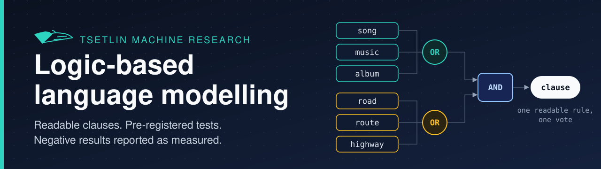

<p align="center"></p>

<p align="center">
  <a href="#status-per-study">Studies</a> |
  <a href="#results">Results</a> |
  <a href="docs/results-overview.md">All registered ids</a> |
  <a href="docs/known-limitations.md">Limitations</a> |
  <a href="research/README.md">Ideas and roadmap</a> |
  <a href="docs/data.md">Data</a> |
  <a href="CITATION.cff">Cite</a>
</p>

# Measured steps toward a logic-based language model with Tsetlin Machines

**At a glance**

- Three studies (19 Sep to 3 Oct 2026) toward a language model whose knowledge is a set of logical clauses that can be read.
- 91 hypotheses were registered in the first study: 12 are met (six of them with a qualifier), 11 are not met, 7 are not judged and 61 were not run. The [results overview](docs/results-overview.md) lists every id.
- Most of what was measured is negative and is reported as measured: see [Results](#results) and the [known limitations](docs/known-limitations.md).
- A [glass box page](https://anwardebes.github.io/glassbox-lm/) runs the count floor of the programme in the browser and shows every vote. It reimplements the CVTM-core of the first study and holds no Tsetlin Machine ([live/](live/README.md)).
- A clone holds the code, the configs, the registrations and the results pages. Run folders, datasets and saved models are not distributed; the glass box page is the one exception (see [Data](#data)).
- The ideas behind the programme, what the literature says about each of them and the open work are in [research/](research/README.md).

This repository, `glassbox-lm`, holds a research programme that takes measured steps toward a language model built from Tsetlin Machines, in which what the model knows is a set of readable logical clauses. Its three studies date from 19 Sep to 3 Oct 2026. The first built a token-level Tsetlin Machine language model on a sparse engine written for it and compared it with an in-house Kneser-Ney 5-gram model on the same tokens. The second tested the hierarchical Tsetlin Machine procedure of the supervisor's project proposal (unpublished) on artificial data, on two sentence families, on news topics and on Wikipedia paragraph pairs. The third prepares a word-level clause language model; so far it has produced count baselines, one evaluator run without a Tsetlin Machine, and a reproduction of the author's earlier Tsetlin Machine router, Clause-Driven-LLM, that did not meet its first gate. Most of what was measured is negative: the main accuracy goal of the first study was missed, no learned rule of the second study captured either of the two sentence families of the proposal, its single final test is below word overlap, and the third study has not trained a Tsetlin Machine on its language data. The first two studies registered hypotheses or pass rules with thresholds before the runs they govern, and their results pages say where a rule was added, not kept or read after results were known; in the third study one step has a registration so far. The name of the repository states the goal of the programme, a language model that can be read like a glass box. It is not a claim about a model in the repository, and no model here is called a large language model.

## The glass box

**[Open the glass box](https://anwardebes.github.io/glassbox-lm/)**: the count floor of [research/design.md](research/design.md), counted in the browser from ten public-domain books.

https://github.com/user-attachments/assets/5b06241d-a0be-4f2a-89bf-f9d824464df2

The page counts the books in the browser tab and predicts the next word with the CVTM-core of tm_language_model (section 11 of its [engine specification](studies/tm_language_model/docs/11-engine-spec.md)): Kneser-Ney 5-gram suffix clauses in their exact vote form, the document clauses, the pointer clause and the bucketed mixture, with weights fitted by the study's MAP-EM. For every candidate word it shows the clauses that vote, the memory of the text typed so far and the passages where the voting pattern was counted, and it scores 19 held-out chapters when it loads. No Tsetlin Machine runs on the page. A test checks the JavaScript against the study's own Python code on the same tokens, and every probability agrees to within 4e-15. The page, its data and the test are in [live/](live/README.md); its numbers belong to its corpus and are not comparable with those of the studies.

## Status per study

| Study | Question | Status | Headline result |
|---|---|---|---|
| [tm_language_model](studies/tm_language_model/README.md) | Can a token-level Tsetlin Machine language model, trained with Tsetlin feedback on next-token prediction, reach the accuracy of an n-gram baseline at useful speed, and what do its clauses represent? | archived (ran 19 Sep to 1 Oct 2026) | The reproducibility hypotheses were met at the scale tested; the main accuracy hypothesis H1.1 is not met on seed 1 and the registered kill criterion KB7 triggered; 61 of the 91 registered hypotheses were not run. |
| [hierarchical_tm](studies/hierarchical_tm/README.md) | Does the hierarchical Tsetlin Machine procedure of the project proposal learn what the proposal expects? | finished (ran 1 to 3 Oct 2026) | Mostly negative: no learned rule captured either of the two sentence families of the proposal; the model learns relations between Wikipedia paragraphs, and its single final test is below word overlap on both Wikipedia tasks. |
| [clause_lm](studies/clause_lm/README.md) | Do clauses with learned OR-groups of words add predictive value over count statistics, first on word pairs and then inside a language model, and does the same kind of clause help a readable router? | running as preparation (started 2 Oct 2026) | Count baselines and one evaluator ran, without a Tsetlin Machine; the router reproduction did not meet its first gate in its one completed run, and the cause is not confirmed. |

The list of studies with the dependencies between them is in [studies/README.md](studies/README.md).

## Results

The table gives the headline measurements of each study with the run that produced them. Each value is copied from the results page of its study, which names the file of the run folder and gives the remaining conditions. The statuses of all registered ids are collected in [docs/results-overview.md](docs/results-overview.md).

| Study | Measurement | Value and comparison | Registered id and status | Run id |
|---|---|---|---|---|
| tm_language_model | Causal model at V = 8000 with 1,048,576 clauses, seed 1: bits per byte on the WikiText-103 test split | 2.2193, against 1.3719 for the in-house Kneser-Ney 5-gram on the same tokens (ratio 1.618). Single seed, one read of the test split, and 0.114 of the test 8-grams also occur in the training split. | H1.1 not met, on seed 1 only (seeds 2 and 3 not run); kill criterion KB7 triggered | `20260923T042350Z_CP_anchor` |
| tm_language_model | Count-vote read-out of the clause bank of that run (causal arm of H8.1): bits per byte on the validation split | 1.8280, against 2.1749 for the signed votes of the same bank. The comparison is with the model's own read-out, not with the n-gram baseline; the results page places this read-out at the level of a Kneser-Ney bigram. | H8.1 met; compared with the model's own signed votes; the causal arm uses a bank seen in the exploratory evaluation | `20260924T062704Z_cvtm_H8_1_causal_cp20M` |
| tm_language_model | Confirmatory self-supervised text runs, seeds 1 to 3: Q_text (accuracy of a few-label probe on three text classification sets, in points) of the winning arm minus the stronger control, its own young bank | +0.09 (-1.51 to +1.78) on the all-clauses code, which decides, and -4.57 (-6.16 to -2.47) on the dimension-matched code. Registered threshold: at least 1.0 point, interval excluding 0. | H17.1 not met | `20260930T163619Z_ssl_r1cf_report_confirmatory` |
| tm_language_model | The same report: Q_text of the winning arm minus bag of words | -5.85 (-7.31 to -4.23) on the all-clauses code, which decides, and -12.41 (-14.32 to -10.44) on the dimension-matched code. Registered threshold: at least 2.0 points, interval excluding 0. | H17.2 not met | `20260930T163619Z_ssl_r1cf_report_confirmatory` |
| hierarchical_tm | The one final test, mean of 5 seeds: test AUC on same-article pairs | 0.735, against 0.817 for word overlap and 0.869 for the baseline that was best on dev, a logistic regression | The final test: not met, in the sense of the registered comparison "beats X"; the registered outcome is "below" | `20261002T193513Z_final_test_main_table` |
| hierarchical_tm | The same test: test AUC on next-paragraph pairs | 0.750, against 0.857 for word overlap and 0.903 for the baseline that was best on dev, a logistic regression | as above | `20261002T193513Z_final_test_main_table` |
| hierarchical_tm | The same test: test AUC on next-paragraph pairs with every shared word removed | 0.614, against 0.811 for the baseline that was best on dev, a PPMI word-vector cosine. Word overlap is 0.500 on this data by construction, which is not a comparison. | as above | `20261002T193513Z_final_test_main_table` |
| clause_lm | Gate 0 of M5 step 1, the reproduction of the lexical Clause-Driven-LLM router on CLINC150 (s 8, seed 42): test accuracy | 0.5407; the registered rule is a test accuracy within 0.005 of 0.82778. One completed run with one seed on the numba CPU backend. The published `studies/clause_lm/src/m5_run.py` is a later revision than the one that ran, and the commit of the upstream copy is recorded in project notes, not checked against upstream. | Gate 0 not met; cause not confirmed; a retry was stopped without a score | `20261002T195255Z_m5_gate0_s8_seed42_sorted` |
| clause_lm | Perplexity on the Penn Treebank validation split: Kneser-Ney trigram model alone, and with the count votes of k-means word groups (no Tsetlin Machine) | 161.72 and 157.24, from a single run | no registered id; the bar that milestone M2 (not run) has to beat | `20261002T174323Z_clause_lm_kmeans200` |

The limits of these numbers, among them duplicate articles in the test split of the Wikipedia pair data, are on the page of [known limitations](docs/known-limitations.md). The README of hierarchical_tm lists the claims that are not made on the strength of that study.

## Ideas, design and open work

The folder [research/](research/README.md) holds what comes before the next study, and nothing in it has been run. [ideas.md](research/ideas.md) records the ideas the programme started from, with the [pages of the writing board](research/board/README.md) they were written on. [findings.md](research/findings.md) gives what a literature search found about each idea, negative verdicts included. [design.md](research/design.md) is the design that follows from it, a count floor without any Tsetlin Machine and a test bench in which Tsetlin learning is measured against a twin that only counts. [roadmap.md](research/roadmap.md) lists what the studies registered or prepared and did not run, and what comes next.

## Layout

```
README.md               this page
CHANGELOG.md            history of the repository
CONTRIBUTING.md         conventions for changes
CITATION.cff            citation metadata
LICENSE                 CC BY-NC 4.0
docs/                   what spans the studies
  README.md             index of the folder
  results-overview.md   statuses of the registered ids and headline numbers
  known-limitations.md  what limits the use of the repository and of its results
  data.md               the datasets and how to obtain them
  references.md         bibliography
  upstream-repositories.md
  run-index.md          one row per run folder of the three studies
  hash-table.md         SHA-256 pins, as registered and as published
  assets/               banner and logo
research/               ideas, literature findings, design and roadmap; nothing run
  README.md             index of the folder and how far to trust it
  ideas.md  findings.md  design.md  roadmap.md
  board/                the pages of the writing board, photos and readings
studies/
  README.md             list of studies, their dependencies, how a study is added
  tm_language_model/    README.md, pyproject.toml, Makefile, src/tmlm/, experiments/, tests/,
                        scripts/, env/, launch/, docs/, third_party/
  hierarchical_tm/      README.md, gates.md, frozen_settings_hashes.json, src/, queue/, docs/
  clause_lm/            README.md, src/, docs/
live/                   the glass box page: the count floor in the browser, its data and its test
.github/workflows/      the test and the deployment of the page
```

Each study keeps its registration, its results page and its data cards in its own folder. The folders `results/` (run folders) and `data/` (datasets) of a study are local and are ignored by git, as are the virtual environments.

## Setup

Nothing is built at the repository root. Each study README gives the commands of its study, and they are run from the study folder. The tm_language_model study has a Makefile, whose targets (`help`, `env-check`, `lint`, `test`, `smoke`, `bootstrap`, `configs-check`) are reached from the root with

```bash
make -C studies/tm_language_model <target>
```

`studies/tm_language_model/env/bootstrap.sh` builds two virtual environments inside the study folder and `studies/tm_language_model/env/htm_install.sh` a third; the lock files in `studies/tm_language_model/env/` record the package versions. The bootstrap needs `nvcc` and `g++` and asserts a GPU of CUDA compute capability 7.0. It installs the vendored GraphTsetlinMachine package in editable mode. hierarchical_tm and clause_lm have no environment script of their own: their launchers start jobs through scripts of tm_language_model, so the three study folders have to stay next to each other ([studies/README.md](studies/README.md)). The code encodes the workstation of the recorded runs, one Tesla V100 and a quota of 6 CPUs.

## Data

No dataset is distributed, and neither are derived data or saved models. [docs/data.md](docs/data.md) names the source and the version of each dataset and says how to obtain it. The data cards of hierarchical_tm are in `studies/hierarchical_tm/docs/`.

The one exception is the glass box page: [live/](live/README.md) holds the token ids of ten public-domain books (`tokens.u16.gz`) and the mixture weights fitted on them (`core.json`), which the page needs. `live/export.py` downloads the books and rebuilds both.

## What a clone allows

A clone holds the code, the configs, the registrations, the results pages and the [run index](docs/run-index.md). The registrations are [docs/13](studies/tm_language_model/docs/13-preregistration.md) of tm_language_model, [gates.md](studies/hierarchical_tm/gates.md) and the [registrations page](studies/hierarchical_tm/docs/registrations.md) of hierarchical_tm, and the [registration of M5 step 1](studies/clause_lm/docs/prereg_M5_step1.md) of clause_lm. A reader can compare a status or a number on a results page with the registered rule, read the code that the page names, and look up a cited run id in the run index.

A clone holds no run folder, no dataset, no saved model, no compiled engine binary and no virtual environment, so no number can be recomputed or inspected from the clone alone. Reproducing a number means obtaining the data, building an environment from the lock files and running the experiment again on comparable hardware. The sentence files of the slide-6 and slide-10 tests of hierarchical_tm are not distributed either, because they carry sentences of the project proposal, so those checks cannot be rerun from a clone.

The numbers check of tm_language_model needs the run folders: `make lint` accepts a number that is labelled as measured in the study's documents only when the cited folder exists under `results/`, so without the run folders `make lint` and `make smoke` fail, and two tests of `make test` depend on run folders as well.

The glass box page is the part that a clone can rerun: `python live/export.py` rebuilds its data with the study's code on a CPU, and `npm test` in `live/` checks the page against it.

The published tree was not run: the tests, the experiments and the installs were last run on the working copies. The published files are copies of those, edited for publication: references to unpublished working notes and plans, paths of the workstation and remarks on day-to-day work were removed or reworded in documents, comments and docstrings. The edits were not exercised by a run; the page of [known limitations](docs/known-limitations.md) says what follows from this.

## Author and supervision

The work is by Anwar Debes, master's student at the University of Agder, Centre for Artificial Intelligence Research (CAIR). The supervisor is Ole-Christoffer Granmo, and the hierarchical_tm study tests the procedure of his project proposal (unpublished). He has not reviewed the code, the registrations or the results of this repository. The decisions that the records call recorded decisions are the author's, and so is any error.

## Licence

Copyright (c) 2026 Anwar Debes. The code and the documents of this repository are released under the Creative Commons Attribution-NonCommercial 4.0 International licence (CC BY-NC 4.0, [LICENSE](LICENSE)): they may be used, shared and adapted for non-commercial purposes with credit to the author. The vendored package in `studies/tm_language_model/third_party/GraphTsetlinMachine` keeps its upstream MIT licence file. The datasets are not distributed and keep their own licences ([docs/data.md](docs/data.md)).

## Citation

See [CITATION.cff](CITATION.cff).
