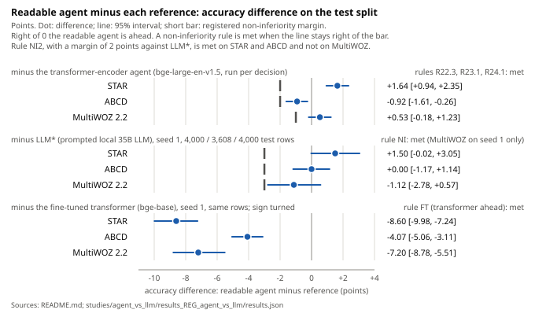
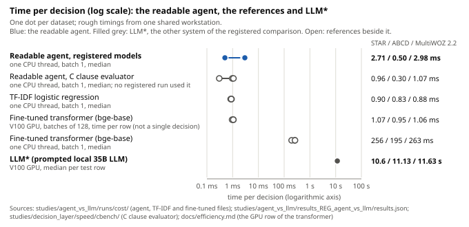
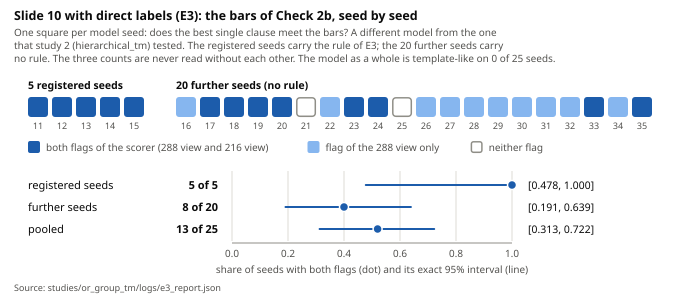
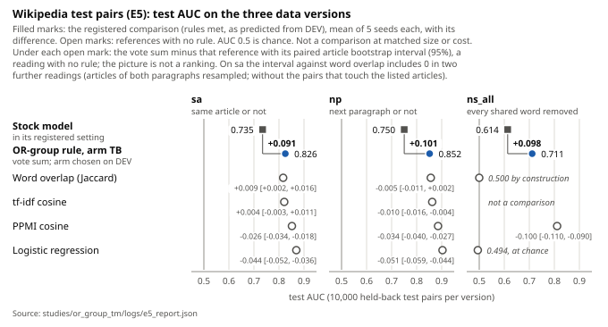
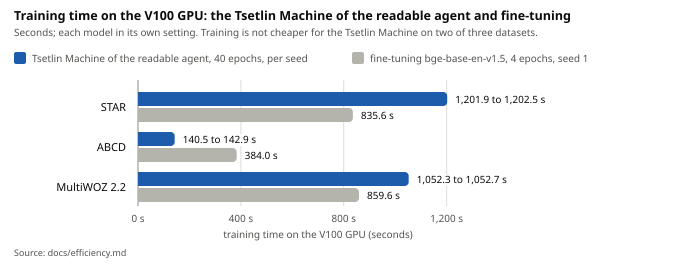

# Measured steps toward a logic-based language model with Tsetlin Machines

Final report

- Author: Anwar Debes
- Affiliation: University of Agder, Centre for Artificial Intelligence Research (CAIR)
- Date: 19 November 2026
- Repository: https://github.com/AnwarDebes/glassbox-lm
- PDF of this report: [glassbox-lm-final-report.pdf](glassbox-lm-final-report.pdf)

## 1. Summary

**Question.** How far do Tsetlin Machines, whose knowledge is a set of readable logical clauses, get on language? I asked this in three forms: for a language model, for the hierarchical procedure of my supervisor's project proposal (unpublished), and for the decision layer of dialogue agents. Ten studies ran from 19 Sep to 12 Nov 2026 on one shared workstation. Registered rules are rules that I fixed in text files of the repository before their runs (section 10; exceptions in section 4), and negative results are reported like the others.

**Three findings hold, each with its limits.**

1. **A dialogue agent with no neural network at any stage is not worse, within the registered margins (2.0, 2.0 and 1.0 points), than the same agent reading a transformer encoder**: +1.64 [+0.94, +2.35], -0.92 [-1.61, -0.26] and +0.53 [-0.18, +1.23] points of next-action accuracy on the test splits of STAR, ABCD and MultiWOZ 2.2 (95% intervals; on ABCD the interval lies below 0, inside the margin). It is also not worse than a prompted local 35B LLM by 3 points (margin set after a dev result; on MultiWOZ on seed 1 and not on the 5-seed mean), and it decides in 0.50 to 2.98 ms on one CPU thread, where the LLM needs 10.6 to 11.63 s on a GPU. Limits: "better than" is met against neither; the STAR and ABCD test splits had been used many times; TF-IDF logistic regression is level or ahead and decides in under 1 ms; a fine-tuned transformer is 4.07 to 8.60 points ahead; thousands of logged dialogues are needed.
2. **The hierarchical machine of the package named in the proposal [9] is above the flat machine of the same package** on one dialogue workflow: +9.40 [+8.35, +10.41] points, and +7.02 [+6.01, +8.04] against a flat machine with as many automata. Limits: one task, on the eighth and tenth use of its test split; size and settings differ as well as the structure; it is 2.28 points below the study's own flat Tsetlin Machine.
3. **A learning rule for the clause form of the proposal (study 10, the newest, 12 Nov 2026).** The OR-group rule learns clauses that are ANDs of OR-groups of words on one CPU thread. On the slide-10 sentence family, with direct labels and a different model from the one that study 2 tested, the best single clause meets the bars of Check 2b, the slide-10 check of that study (both flags of its scorer), on 5 of 5 registered seeds, on 8 of 20 further seeds and on 13 of 25 pooled. On the held-back Wikipedia test pairs its arm TB (chosen on DEV) is above the stock model in its registered setting, as predicted from DEV, by +0.091, +0.101 and +0.098 AUC of the vote sum on the three data versions; the stock model is the model of the hierarchical package as study 2 ran it, and this is not a comparison at matched size or cost. Limits: the pair version of slide 10, which is the procedure of the proposal, met no bar on the DEV sentences, and the model as a whole is not template-like on any of the 25 seeds; in the Wikipedia runs every clause is one OR of words shared by both paragraphs (tied groups, not in the plan of the design), and a second setting of the package was higher on DEV and has no test score; there is no rule against word overlap; the vote sum minus PPMI cosine has its interval below 0 on all three versions, and minus the logistic regression on the two versions on which that baseline is not at chance.

**What did not work.** The token-level language model missed its accuracy goal (2.2193 against 1.3719 bits per byte for the n-gram baseline, on seed 1 only), and with the package the procedure of the proposal ended below word overlap in its one final test (test AUC 0.735 and 0.750 against 0.817 and 0.857; section 7).

## 2. The question

**Three sub-questions, each with a registered criterion.**

1. **Language model.** Does a token-level Tsetlin Machine language model reach an n-gram baseline (rule H1.1, bits per byte)? No (section 7).
2. **The proposal.** Does its procedure learn one clause for a sentence family (Check 2b) and score higher than word overlap on Wikipedia pairs (one final test)? Not with the package (section 7); for a different model see section 4.3.
3. **Decision layer.** Is an agent with no neural network not worse, within registered margins, than one reading a transformer encoder and than a prompted LLM? Yes, within the limits of section 4.1.

**The clause form.** The project proposal is unpublished, so this report describes its slides by structure only. Its unit is a clause that is an AND of OR-groups, where a group is an OR of single words; in symbols, (w1 OR w2 OR w3) AND (w4 OR w5). The clause fires on a text when every one of its groups finds at least one of its words in the text. The slides show a concept as an OR of words (slide 8), one clause for a whole sentence family (slide 10), and a self-supervised procedure in which the model is told only whether two paragraphs or sentences come from the same document (slide 11).

**Why I ask for a logic-based model that needs no GPU.** Readable: the knowledge of a Tsetlin Machine [1] is a set of clauses that can be read one by one. Cost: the prompted LLM of section 4.1 needs a GPU and 10.6 to 11.63 s for one decision, while a model that looks words up in clauses can decide on one CPU thread. Low power is the goal behind this and not a result: no CPU energy was measured and no low-power hardware was tried (section 5). Whether such a model reaches useful accuracy on language is the open question. No model built here is called a large language model.

**Related work.** Tsetlin Machine word embeddings exist, evaluated as embeddings and not as a language model [10]. The nearest prior work to a Tsetlin Machine language model, as the bibliography describes it, predicts the next character of a word and reports no perplexity [4]; its searches found no word-level one scored by perplexity against n-gram baselines (an absence is not proven). Background on convergence and on reasoning by elimination is in [2, 3]; `docs/data.md` names the source and version of each dataset.

**How it was tested.** Section 10 says what a registration is and what its time rests on, and section 4 how often each test split had been used; the newest study chose its rule, its settings and two readings on development data (DEV). The results pages say where a rule was added, not kept or read after results were known.

## 3. What was done

**Ten studies** (Table 1) follow three lines: the language model (studies 1, 3, 5 and 8), the proposal (study 2 with the package, study 10 with a different model for the same clause form) and the dialogue agent (studies 4, 6, 7 and 9).

**Contribution.** A registered record of ten studies with their negative results (Tables 2 and 8); the readable agent and its comparisons (section 4.1); a test of the proposal's procedure with the package (study 2); the OR-group rule with three registered tests and their limits (section 4.3).

**Table 1.** The ten studies. Ids as in `docs/results-overview.md`; Table 8 says what each id that is not met tested. A period that starts with "from" belongs to a study that the repository lists as running. Source: `README.md` (status table); `docs/results-overview.md`.

| No. | Study | Period in 2026 | Question | Outcome |
|---|---|---|---|---|
| 1 | tm_language_model | 19 Sep to 1 Oct | A token-level Tsetlin Machine language model against an n-gram baseline | Not met: 2.2193 against 1.3719 bits per byte, on seed 1 only. The reproducibility hypotheses are met at the scale tested. |
| 2 | hierarchical_tm | 1 to 3 Oct | The hierarchical procedure of the proposal, run with the package | Mostly negative: 5 of 9 pass-rule entries met; the one final test is below word overlap. |
| 3 | clause_lm | from 2 Oct | Preparation of a word-level clause language model, and a readable router | 12 ids with a status; only one step of the study has a registration. Its one registered question has a negative answer. |
| 4 | decision_layer | from 15 Oct | The Tsetlin Machine as router, readable decision layer and dialogue agent | 72 of 107 ids met; the agent result of section 4.1; the one superiority rule against the encoder agent (R24.2) is not met. |
| 5 | tally | from 15 Oct | A language model built from counts, with a Tsetlin Machine test bench | T0 not met; A2 met, a result about count models. |
| 6 | text_understanding | 16 to 25 Oct | Text classification with bits from static word tables | Mixed: M1 met on reused test splits; H1 of M2 not met. |
| 7 | agent_guards | 20 to 26 Oct | Rule and Tsetlin Machine guards around a local LLM agent | Negative: E4.2 not met. |
| 8 | language_part3 | 21 to 23 Oct | A Tsetlin Machine that writes text against counting systems | Stopped at its gates. |
| 9 | agent_vs_llm | 26 to 30 Oct | The readable agent against prompted local LLMs and a fine-tuned transformer | Not worse than a prompted local 35B LLM (LLM\*) by 3 points on three datasets (MultiWOZ on seed 1 only; by 2 points on STAR and ABCD only), better on none; a fine-tuned transformer is ahead. |
| 10 | or_group_tm | 12 Nov | A learning rule for clauses made of OR-groups of words | E1 (planted groups) met. E3 (slide 10, direct labels, a different model from study 2): the bars of Check 2b (both flags of the scorer) on 5 of 5 registered seeds, 8 of 20 further seeds, 13 of 25 pooled. E5 (Wikipedia test pairs, three data versions): above the stock model in its registered setting by +0.091, +0.101 and +0.098 AUC of the vote sum, as predicted from DEV; not a comparison at matched size or cost. Slide 10 as pairs and synthetic sequences: not met. |

**Registered rules** (Table 2). In studies 1 to 5, 223 ids carry a status. "Met" is not always a positive result: the counts hold procedural steps, non-inferiority rules and a negative-result rule, so they describe the bookkeeping, not a success rate. Studies 6 to 10 add 24 status rows of mixed kind, such as "partly met"; the results overview lists them per study.

**Table 2.** Registered ids with a status. Source: `docs/results-overview.md`; the sums are arithmetic on its rows.

| Study | Ids with a status | Met | Not met | Not run | Not judged |
|---|---|---|---|---|---|
| tm_language_model | 91 | 15 | 14 | 57 | 5 |
| hierarchical_tm | 9 | 5 | 4 | 0 | 0 |
| clause_lm | 12 | 4 | 3 | 5 | 0 |
| decision_layer | 107 | 72 | 32 | 3 | 0 |
| tally | 4 | 3 | 1 | 0 | 0 |
| Sum | 223 | 99 | 54 | 65 | 5 |

**Run folders.** The run index lists 1,185 run folders of studies 1 to 5: 650 of tm_language_model, 381 of hierarchical_tm, 125 of tally and 29 of clause_lm; decision_layer keeps result files instead and has no rows, and the later studies keep their run records on their own pages. More than half of the listed folders belong to study 1; the count does not measure the effort across the ten studies. The newest study ran on one day: its nine texts (eight plans and one dated note) were fixed on 12 Nov 2026 between 15:53:26Z and 21:05:33Z, each with the SHA-256 of its text and of the code.

**Intervals.** Unless a sentence says otherwise, an interval is a 95% percentile bootstrap interval of a difference (the captions of Figure 1 and Table 4 say what is resampled), and none is adjusted for the number of rules or readings.

## 4. Results that hold, each with its limits

### 4.1 The readable agent against a transformer encoder and a prompted LLM

**What it is.** The readable agent chooses the next action among fixed actions in logged dialogues (187 actions on STAR, 30 on ABCD, 128 on MultiWOZ 2.2); it writes no text. It has no neural network at any stage: C4 text, a word list, counting and SVD, k-means and thresholds give a word table, and a Tsetlin Machine reads its bits together with memory bits of the actions already taken.

**Against a transformer encoder.** The readable agent is not worse, within the registered margin, than the same agent reading a frozen transformer encoder (the encoder agent; bge-large-en-v1.5, 335M parameters, run per decision): 65.3% against 63.7% on STAR, 83.6% against 84.6% on ABCD and, as a fraction, 0.3437 against 0.3384 on MultiWOZ 2.2 (Figure 1; rules R22.3, R23.1 and R24.1). On STAR the interval lies above 0; on ABCD it lies below 0 (the readable agent is lower there, inside the margin); on MultiWOZ it includes 0. All three are non-inferiority rules.



*Figure 1. Readable agent minus each reference on the test split, in points, with 95% intervals and the registered non-inferiority margins (2.0, 2.0 and 1.0 points against the encoder agent, 3 points against LLM\*; rule NI2, with a margin of 2 points against LLM\*, is met on STAR and ABCD and not on MultiWOZ). Each interval, like those of section 4.2, comes from a bootstrap over the test dialogues, 10,000 draws; in the top group each agent enters with the mean of its 5 seeds, and the two lower groups are seed 1 on the test rows of Table 3. The last group shows the readable agent minus the fine-tuned transformer (-8.60, -4.07 and -7.20), the registered difference of rule FT (fine-tuned minus agent: +8.60, +4.07 and +7.20) with its sign turned. No rule of the form "better than" is met (R24.2 against the encoder agent, SUP against LLM\*). Sources: `README.md`; `studies/agent_vs_llm/results_REG_agent_vs_llm/results.json`; `studies/decision_layer/docs/results.md` (the encoder and its rules).*

**Against a prompted LLM.** LLM\* is the local configuration that was best on dev: Qwen3.6-35B-A3B at 4 bits with 50 retrieved examples. On the test rows the readable agent (seed 1) minus LLM\* is +1.50 [-0.02, +3.05], +0.00 [-1.17, +1.14] and -1.12 [-2.78, +0.57] points: not worse by 3 points on all three datasets (rule NI; MultiWOZ on seed 1 only) and better by 3 points on none (rule SUP).

**Table 3.** Test accuracy (seed 1, as a fraction) on the 4,000 / 3,608 / 4,000 test rows of the registered comparison with LLM\*, and time per decision, STAR / ABCD / MultiWOZ 2.2. The accuracies are those of that comparison, not those of the registered tests against the encoder agent in the text above; on STAR and MultiWOZ its rows are a random sample of the test split. Sources: `studies/agent_vs_llm/results_REG_agent_vs_llm/results.json`; `studies/agent_vs_llm/REG_agent_vs_llm.md` (the rows; the LLM configurations: eight on STAR, six on ABCD, four on MultiWOZ); `docs/efficiency.md`.

| System | Test accuracy | Median time per decision; the rows it is taken over |
|---|---|---|
| Readable agent (no neural network at any stage) | 0.6490 / 0.8379 / 0.3548 | 2.71 / 0.50 / 2.98 ms, one CPU thread; 1,000 dev rows |
| LLM\* (prompted local 35B LLM) | 0.6340 / 0.8379 / 0.3660 | 10.6 / 11.13 / 11.63 s, V100 GPU; its test rows |
| Fine-tuned transformer (bge-base, about 110M parameters) | 0.7350 / 0.8786 / 0.4268 | 256 / 195 / 263 ms, one CPU thread; 300 dev rows. About 1 ms per row in GPU batches (a dev pass divided by its rows) |
| TF-IDF logistic regression | 0.6455 / 0.8473 / 0.3540 | 0.90 / 0.83 / 0.88 ms, one CPU thread; 1,000 dev rows |

**Time.** The registered models of the readable agent decide in a median of 2.71, 0.50 and 2.98 ms on one CPU thread. LLM\* needs 10.6, 11.13 and 11.63 s per test row on the V100 GPU, about 3,900 to 22,000 times the time of the readable agent (Figure 2, Table 3). With a C clause evaluator the same registered models decide in a median of 0.96, 0.30 and 1.07 ms; the evaluator gives the same class sums on all dev rows, and no registered run used it. The timings are rough: one shared workstation.



*Figure 2. Time per decision on a logarithmic axis, one dot per dataset. Sources: the cost files under `studies/agent_vs_llm/runs/cost/`; `studies/agent_vs_llm/results_REG_agent_vs_llm/results.json`; `studies/decision_layer/speed/cbench/`; `docs/efficiency.md`.*

**Limits.**

- **Not "better than".** The one registered superiority rule against the encoder agent (R24.2, MultiWOZ) is not met: the interval [-0.18, +1.23] is not above 0. Against LLM\*, SUP is met on no dataset.
- **Not specific to the Tsetlin Machine.** TF-IDF logistic regression is level or ahead: the readable agent minus TF-IDF (STAR, ABCD, MultiWOZ; seed 1, no rule) is +0.35 [-1.00, +1.72], -0.94 [-1.92, +0.03] and +0.07 [-1.32, +1.47] points, each interval includes 0 (5 seeds resampled, ABCD: [-1.95, -0.23], below 0), and it decides in under 1 ms (0.83 to 0.90 ms), faster than the readable agent on STAR and MultiWOZ. On the same bits, the Tsetlin Machine minus logistic regression is -0.09 [-0.90, +0.73] on STAR (R22.2) and -1.55 [-2.32, -0.79] on MultiWOZ (no rule); ABCD had no such arm.
- **A fine-tuned transformer is ahead**: fine-tuned minus agent +8.60 [+7.24, +9.98], +4.07 [+3.11, +5.06] and +7.20 [+5.51, +8.78] points.
- **Thousands of logged dialogues are needed.** On dev, with 64 or 256 logged dialogues LLM\* leads by 6.6 to 48.0 points; the agent reaches LLM\* (point estimates) from 4,096 dialogues on STAR and at no pool size on ABCD or MultiWOZ (one pool draw, one agent seed).
- **Margin, seeds and splits.** The 3-point margin was set after a dev result (disclosed in the registration); at a margin of 2 points (rule NI2) the rule is met on STAR and ABCD and not on MultiWOZ. On MultiWOZ the 3-point rule holds on seed 1 only, not on the 5-seed mean (-1.70 [-3.21, -0.14], interval below 0); on STAR and ABCD the 5-seed mean keeps it (+1.28 [-0.26, +2.84], -0.14 [-1.23, +0.91]); seed 1 is the best of the 5 seeds on the MultiWOZ rows, though it was fixed as the statistic before the run. The MultiWOZ result uses a training rule chosen on MultiWOZ dev. The test splits were reused: the comparison with the encoder agent was the 6th use of STAR's test split, the 14th of ABCD's and the 1st of MultiWOZ's, and the one with LLM\* was use number 7, 15 and, on MultiWOZ, 2. LLM\* is the dev-best of 4 to 8 local configurations, not the best LLM that exists. The evaluation is offline, on logged dialogues.
- **How far "readable" goes.** The timed agents hold 3,995 to 16,000 clauses with 52,135 to 936,967 literals. With clauses of at most 3 literals the agent is 2.81 to 4.11 points below logistic regression on dev (the dev check allowed 2.0; `studies/decision_layer/docs/results.md`).

### 4.2 The hierarchical machine against the flat one of its package

On the ABCD workflow of study 4 (test split, 3 seeds each) the hierarchical Tsetlin Machine of the package named in the proposal [9] is +9.40 [+8.35, +10.41] points above the flat machine of the same package (81.7% against 72.3%; rule R16.1, met), and +7.02 [+6.01, +8.04] above a flat machine with as many automata (74.7%; rule R16b.1, met). Sources: `docs/results-overview.md`; `README.md` (results table); `studies/decision_layer/docs/results.md` (settings and uses of the test split).

**Limits.** Size and settings differ as well as the structure, so the gain is not the AND-OR structure's alone (16 times the automata, T 1,000 and s 25 against T 200 and s 4; against the flat machine with as many automata, T, s and the vote still differ). With no rule, the hierarchical machine minus the study's own flat Tsetlin Machine (84.0%) is -2.28 [-2.92, -1.68] points, and the package's flat machine is 11.7 points below that machine (cause not tested). It concerns one task, on the eighth and tenth use of the ABCD test split. R16b was registered when the results of R16 were known. No model was saved, so no hierarchical clause can be shown. The hierarchy that was tried before this one did not learn (the shape and the settings matter).

### 4.3 The OR-group rule: a learning rule for the clause form of the proposal

**Why it was built.** Three days with one version of the package (study 2) left open whether its misses came from the clause form or from the way the clauses were learned. Study 10 does not settle that: it takes the clause form, the data and the scorers of study 2 and tests a different model with other sizes and settings, and the package was not run on equal terms (section 9). The OR-group rule is a different model from the package [9], and the study does not test the package.

**The rule.** Each group holds one Tsetlin automaton per word; a word is a member of the group when its state is 0 or more, and a group with no member is false. The vote sum is the number of clauses that fire. Learning goes example by example under the vote gate of a Tsetlin Machine. A clause that takes part gets one of five events:

- **seed** (it should fire and its false groups have no member): the words of the text become members of the empty groups;
- **reinforce** (it should fire and fires): its members that occur in the text gain 1;
- **recruit** (it should fire and does not): in the false groups that the setting names, the words of the text that are not yet members gain 1, and a word whose state reaches 0 joins the group;
- **reject** (it should not fire but fires): the present members of one group lose 2 in most settings;
- **repress** (it should not fire and does not): in the false groups that the setting names, the present non-members lose 1.

A word can become a member only after it has occurred in an example on which the clause should fire, so a clause cannot learn a list of words that only the negative examples contain. The model is flat: clauses of OR-groups with feedback of its own. Neither the clause form nor the training signal is new [5, 6, 7, 8], and no claim of a first is made.

**Planted word groups (E1, registered): met.** On artificial worlds of five seeds that the design had not used, the rule meets the three bars of Check 2a of study 2 (plain dev accuracy at least 0.90, group recovery at least 0.80, plain accuracy on word pairs held out of training at least 0.85) on 5 of 5 seeds each; group recovery is 1.0. Limits: an earlier form of the rule missed the bars and was changed after those results were seen (post hoc), and the worlds come from the generator the rule was designed on.

**Slide 10 with direct labels (E3, registered).** The data are one template family: six brackets of alternatives, 288 sentences (216 in the view of the slide), with negated twins, near-miss and broken sentences as negatives. The model has 20 clauses of 12 groups and trains in 2.6 s on one CPU thread (20 passes, `studies/or_group_tm/docs/cost.md`; a registered run with scoring took 4.96 to 5.12 s).

The three counts are never read without each other (Figure 3): with direct labels, the bars of Check 2b (both flags of the scorer) hold on 5 of 5 registered seeds [0.478, 1.000], on 8 of 20 further seeds [0.191, 0.639], which carry no rule, and on 13 of 25 pooled [0.313, 0.722] (exact 95% intervals of the share). The 20 further seeds were named in the text of E3 before any run and ran in its job. On 10 of the 12 seeds without both flags only the flag of the 216 view fails. The model of E3 is a different model from the one that study 2 tested, and that study's verdict on Check 2b stands.

E3 fixed the wording of this result, printed here word for word with its two companion sentences (never read without the three counts above):

> With direct family labels and a setting chosen on the DEV sentences, on 5 of 5 new seeds the best single clause of the model (picked by the study's scorer on the training sentences) accepts at least 90% of the 101 held-back sentences of the slide-10 template family (and of the 80 among them that are in the 216 view), fires on at most 5% of the negated, near-miss and broken sentences, and recovers at least 4 of the 6 brackets in the 288 reading; 5 of 5 seeds when both flags of the scorer are required.
>
> The model as a whole (at least one of its 20 clauses fires) accepts 0.117 to 0.304 of the deletion texts (bracket 6: 0.485 to 0.911).
>
> The pair version (the procedure of the proposal) met none of the bars on the DEV sentences.

**Terms of these sentences.** The family has 86 training, 101 DEV and 101 EVAL sentences, and the held-back sentences are the EVAL sentences. "New seeds" are the registered seeds 11 to 15, with which no slide-10 run existed before the freeze. The scorer of Check 2b prints one flag per view of the family (all 288 sentences, or the 216 in the view of the slide); the rule of E3 asks for both flags, which includes at least 4 of the 6 brackets in the 288 reading and in the 216 reading, on at least 3 of the 5 registered seeds. A deletion text is a family sentence with the words of one bracket's alternative deleted and nothing added. "Template-like" means accepting at least 90% of the intact sentences and at most 5% of the deletion texts. No learned clause is printed here, because its words are words of the slide-10 sentences, which are built from sentences of the unpublished proposal.



*Figure 3. Slide 10 with direct labels (E3, a different model from the one that study 2 tested): the seeds on which the best single clause meets the bars of Check 2b (both flags of the scorer; 5 of 5 registered seeds, 8 of 20 further seeds, 13 of 25 pooled). The model as a whole is template-like on 0 of 25 seeds, and the pair version met none of the bars on the DEV sentences. Setting of E3: 20 clauses of 12 groups, T 8, 20 passes; a false group is named for the recruit event when it is the only false one. Sources: `studies/or_group_tm/logs/e3_report.json`; `studies/or_group_tm/registrations/E3_slide10_text.md` (the setting); `studies/or_group_tm/README.md` (the events).*

- **About one half.** With direct labels and a different model, the bars of Check 2b hold on 13 of 25 pooled seeds (5 of 5 registered seeds, 8 of 20 further seeds). With that share, 5 of 5 comes up with probability 0.038 (a post hoc diagnostic; the share includes the registered five): the registered 5 of 5 lies at the lucky end. Other choices among the clauses that tie at the top score give 3 to 5 of the 5 registered seeds and 4 to 12 of the 20 further seeds.
- **More than the family.** A group is an OR of single words, not of phrases: the best single clause accepts 0.861 to 0.907 of the family sentences from which one word of a multi-word alternative was removed (registered seeds; 0.772 to 0.907 over all 25 seeds).
- **Held-back, one family.** Held-back sentences are combinations of alternatives that are in neither the training nor the DEV sentences, while every alternative and every word of the held-back sentences occurs in the training sentences. The result concerns one template family, with settings chosen on its DEV sentences. The near-miss sentences are rule-generated (one fixed substitution per bracket), so the near-miss part of the check is weak evidence. E3 is the seventh completed scoring of the EVAL sentences and the only one by this study.
- **A correction to the text of E3.** It says that the data allow at most 5 of the 6 brackets to be recovered. That holds only for a clause with one group per bracket: a hand-written clause of 8 groups recovers 6 of 6 brackets in the 288 reading (5 of 6 in the 216 reading). That no seed recovered bracket 5 is therefore a property of this learner. No number of E3 changes.

**Wikipedia pairs (E5, registered).** The data are the three data versions of the Wikipedia pairs of study 2, with 1,024 words, 40,000 training pairs and 10,000 held-back test pairs per version: sa (same article or not), np (next paragraph or not) and ns_all (next paragraph with every shared word removed). On the Wikipedia pairs the three rules of E5 are met, as predicted from DEV: on the test pairs of sa, np and ns_all the OR-group rule (arm TB) is above the stock model in its registered setting by +0.091, +0.101 and +0.098 AUC of the vote sum, each with both intervals above 0 (lower ends at least +0.080). These are the only rules of E5. This is not a comparison at matched size or cost (Table 4, Figure 4).

**Table 4.** The three rules of E5 on the test pairs: mean AUC of the vote sum, 5 seeds each (four decimals; the text rounds to three); the OR-group rule against the stock model in its registered setting, as predicted from DEV, not a comparison at matched size or cost. Arm TB: 2,000 clauses of one tied group, T 40, 10 passes; a false group is named for the recruit event when every group of the other paragraph is true. Paired article bootstrap: the articles of one paragraph of each pair (paragraph A) are resampled, 1,000 draws; in the next column the 5 seeds of each side are drawn as well, 10,000 draws. The test AUCs of the stock model were known from the final test of study 2 before E5 was written. Sources: `studies/or_group_tm/logs/e5_report.json`; `studies/or_group_tm/registrations/E5_wikipedia_test.md` (the bootstrap); `studies/or_group_tm/README.md` (the arm).

| Test pairs | OR-group rule, arm TB | Stock model in its registered setting | Difference, paired article bootstrap (95%) | With the seeds resampled | Rule |
|---|---|---|---|---|---|
| sa | 0.8255 | 0.7348 | +0.0907 [+0.0815, +0.0993] | [+0.0803, +0.1009] | R1-sa met, as predicted from DEV |
| np | 0.8519 | 0.7504 | +0.1015 [+0.0934, +0.1096] | [+0.0895, +0.1145] | R1-np met, as predicted from DEV |
| ns_all | 0.7114 | 0.6136 | +0.0978 [+0.0850, +0.1098] | [+0.0842, +0.1107] | R1-ns_all met, as predicted from DEV |

**What this comparison is.** The stock model is the model of the hierarchical package [9] in the setting that study 2 registered for its final test (50 rules of 64 options, 100 passes, on a GPU). Its second setting (2,000 rules) had DEV AUCs of 0.763 to 0.771 (sa) and 0.778 to 0.796 (np), about 0.03 and 0.05 higher, and has no score on the test pairs; against the DEV means of arm TB (0.8272 and 0.8567) the gap to it is about +0.06 and +0.07. Arm TB has 2,000 clauses, 10 passes on one CPU thread and tied groups, which were not in the plan of the design: the two paragraphs share one group, so every clause is a single OR of words that fires on a pair when both paragraphs contain one of its words. "Above the stock model in its registered setting" is about these two models as they were set, not a comparison at matched size or cost. A met R1 was the expected outcome, as predicted from DEV, and is not news: on DEV the differences were +0.090, +0.108 and +0.081 (design seeds 1 to 3). The three versions share articles and words, so the three rules are not independent pieces of evidence.

**A correction to the text of E5.** Its sentence "Seeds 11 to 15 were never run" is wrong. The same 15 models had been trained once before the freeze, in a scratch rehearsal of the registered job, and scored there on DEV pairs only (vote sum minus the stock model: +0.087, +0.106 and +0.082). I had seen these numbers before the freeze. No test pair was read in the rehearsal, and the registered runs gave the 15 models back bit for bit.



*Figure 4. Test AUC on the three versions of the Wikipedia test pairs. Only the difference to the stock model in its registered setting carries a rule (R1 met on sa, np and ns_all, as predicted from DEV; not a comparison at matched size or cost); its three differences come from unrounded means, and Table 4 gives their intervals. The references are readings with no rule: under each open mark stands the vote sum minus that reference with its paired article bootstrap interval (Table 5), and the picture is not a ranking. On ns_all word overlap and tf-idf cosine are not a comparison, by construction. Source: `studies/or_group_tm/logs/e5_report.json`.*

**Readings with no rule** (Table 5). E5 has no rule against word overlap: on DEV the go-bar for such a test (G2) was missed in the vote sum and passed only in the ratio reading, a reading defined after the miss. Each difference is given with the paired article bootstrap interval (95%) and then the interval with the seeds resampled.

**Table 5.** The vote sum minus each reference on the test pairs; readings with no rule. The intervals stand per reading and are not adjusted for the number of readings on the same test pairs (about 30 paired comparisons in the two readings). Source: `studies/or_group_tm/logs/e5_report.json`.

| Reference (its test AUC on sa / np / ns_all) | sa | np | ns_all |
|---|---|---|---|
| Word overlap (0.817 / 0.857 / 0.500 by construction) | +0.009 [+0.002, +0.016] [+0.001, +0.016]; both intervals are above 0, and the interval includes 0 in two further readings (see below) | -0.005 [-0.011, +0.002] [-0.012, +0.002], interval includes 0 | not a comparison (by construction) |
| tf-idf cosine (0.821 / 0.862 / 0.500 by construction) | +0.004 [-0.003, +0.011] [-0.003, +0.011], interval includes 0 | -0.010 [-0.016, -0.004] [-0.017, -0.004], interval below 0 | not a comparison (by construction) |
| PPMI cosine (0.852 / 0.886 / 0.811) | -0.026 [-0.034, -0.018] [-0.034, -0.018], interval below 0 | -0.034 [-0.040, -0.027] [-0.041, -0.026], interval below 0 | -0.100 [-0.110, -0.090] [-0.110, -0.090], interval below 0 |
| Logistic regression (0.869 / 0.903 / 0.494, at chance on ns_all) | -0.044 [-0.052, -0.036] [-0.052, -0.035], interval below 0 | -0.051 [-0.059, -0.044] [-0.059, -0.044], interval below 0 | no reading |

- **The ratio reading.** Readings with no rule: the ratio reading (a Jaccard index over the learned word groups, defined on the DEV pairs after G2 was missed in the vote sum) minus word overlap is +0.030 [+0.023, +0.036] [+0.022, +0.037] on sa and +0.017 [+0.010, +0.023] [+0.010, +0.023] on np, and the vote sum minus word overlap is +0.009 [+0.002, +0.016] [+0.001, +0.016] on sa and -0.005 [-0.011, +0.002] [-0.012, +0.002] on np; for the vote sum on sa the interval includes 0 with the articles of both paragraphs resampled ([-0.001, +0.018]) and without the pairs that touch the 242 listed articles (+0.006 [-0.003, +0.013] [-0.002, +0.014]). Readings with no rule, the vote sum (and the ratio reading, defined on DEV): minus tf-idf cosine +0.004 [-0.003, +0.011], interval includes 0 (+0.025 [+0.019, +0.031], above 0) on sa and -0.010 [-0.016, -0.004], below 0 (+0.011 [+0.005, +0.017], above 0) on np; minus PPMI cosine -0.026 [-0.034, -0.018] (-0.005 [-0.013, +0.002], includes 0) on sa, -0.034 [-0.040, -0.027] (-0.012 [-0.019, -0.006]) on np and -0.100 [-0.110, -0.090] (-0.069 [-0.079, -0.060]) on ns_all, below 0; minus the logistic regression -0.044 [-0.052, -0.036] (-0.023 [-0.031, -0.015]) on sa and -0.051 [-0.059, -0.044] (-0.030 [-0.037, -0.023]) on np, below 0. In the preceding sentence each difference stands with its paired article bootstrap interval only; with the seeds resampled none of its words (above 0, below 0, includes 0) changes, and the study page gives those intervals.
- **Duplicate articles.** Without the test pairs that touch one of the 242 listed test articles (articles with a paragraph that equals a training paragraph as a set of words, over a list of 3,072 words), the vote sum minus the stock model in its registered setting is +0.091 [+0.081, +0.101] [+0.080, +0.102] (sa), +0.103 [+0.094, +0.112] [+0.091, +0.116] (np) and +0.101 [+0.089, +0.115] [+0.087, +0.115] (ns_all) (no rule).
- **Word groups** (not independently recomputed). The groups of the registered sa models hold 2.97 words on average, and the counted groups of the stock model hold 63.5; the two sets are not matched in size. Their scores of topical coherence are on the study page.
- **Limits stated before the run.** A small world: 1,024 frequent words, words as sets. "Held-back" means held-back pairs of articles of the same source. E5 is the second registered use of these test pairs.

## 5. Efficiency: measured, bounded, not measured

All timings come from one shared workstation (one Tesla V100-SXM3-32GB GPU, two Intel Xeon Platinum 8168 CPU packages) and are rough. No registered rule is about cost: the figures were recorded beside the registered accuracy tests, not tested by them. Table 6 keeps the three kinds of figure apart.

**Table 6.** Cost figures by kind (STAR / ABCD / MultiWOZ 2.2 where three values stand). Sources: `docs/efficiency.md`; `studies/or_group_tm/docs/cost.md`; the files named under Figure 2.

| Kind | Quantity | Value |
|---|---|---|
| Measured | Time per decision (Table 3, Figure 2) | readable agent 2.71 / 0.50 / 2.98 ms on one CPU thread; LLM\* 10.6 / 11.13 / 11.63 s on the V100, with 24.4 GB of GPU memory; fine-tuned transformer 1.07 / 0.95 / 1.06 ms per row on the V100 in batches of 128 |
| Measured | GPU board power under LLM\* | mean 188.5 W over 3,600 s of the ABCD test run, the only power trace of that study |
| Measured | Training time on the V100 (Figure 5) | Tsetlin Machine of the readable agent, 40 epochs, per seed: 1,201.9 to 1,202.5 s / 140.5 to 142.9 s / 1,052.3 to 1,052.7 s; fine-tuning, 4 epochs: 835.6 / 384.0 / 859.6 s |
| Measured | Training energy, the one measured comparison (study 1; shared GPU, indicative only) | Tsetlin Machine language model 1,325,675 J above idle; a small transformer 155,520 J: about 8.5 times the energy for a model 0.94 bits per byte worse |
| Measured | OR-group rule on Wikipedia pairs, one CPU thread | training 17.9 s per pass, 10 passes (the package: 13.9 s per pass on a whole V100, 100 passes); 285 microseconds per pair (the package: not measured alone, a loose upper bound of 164 microseconds per pair on the GPU); model 22.1 kB as (group, word) pairs (the package's model: 124.1 kB as pairs); the two models differ in size and setting, so this is not a comparison at matched size or cost |
| Bounded | Energy per decision, readable agent against LLM\* | when charged with the rated power of a whole CPU package (205 W): 0.556 / 0.103 / 0.611 J against 1,993 / 2,175 / 2,165 J (traced GPU board power times the mean time per dev row, not the median time per test row of Table 3, while the agent figure uses its median time; the power trace of the ABCD run is used for all three datasets), about 3,500 to 21,000 times less; when charged with both CPU packages, about 1,800 to 10,600 times less |
| Bounded | Energy of the OR-group rule on the slide-10 sentences (direct labels) | about 0.5 kJ per run when charged with the rated power of a whole CPU package (a bound from rated power, not a measurement and not a strict upper bound), beside the 35 to 38 kJ of GPU board energy measured for a run of the package [9] (commit f40b2a3; descriptive runs, checked only by their own scripts); not a comparison at matched size or cost |
| Not measured | | the CPU energy of any system (the container exposes no readable CPU energy counter); the power of the fine-tuned transformer, of TF-IDF logistic regression and of the training of the readable agent; the GPU power during the STAR and MultiWOZ runs of LLM\*, and the host beside the GPU board; any low-power or embedded hardware |



*Figure 5. Training time on the V100 GPU, each model in its own setting. The bar of the Tsetlin Machine ends at the upper end of the range of its 5 seeds, which its label gives; fine-tuning is seed 1 of a dev run. Source: `docs/efficiency.md`.*

**What holds.** For choosing among a fixed set of actions, once a few thousand logged dialogues exist, a small classifier with no neural network at any stage is not worse than a prompted local 35B LLM by 3 points (rule NI; margin set after a dev result; MultiWOZ on seed 1 only; by 2 points on STAR and ABCD only) and decides about 3,900 to 22,000 times faster, on a CPU thread instead of a GPU.

**What does not follow.** The energy figures of the readable agent and of the OR-group rule are time multiplied by a rated power: bounds from rated power, not measurements. Short bursts can exceed the rating, so the figures are not strict upper bounds. The figures show no accuracy per joule and no advantage of the Tsetlin Machine: TF-IDF logistic regression is level or ahead in accuracy and decides in 0.83 to 0.90 ms, faster than the readable agent on STAR and MultiWOZ. They show no cost advantage over a fine-tuned transformer, which may cost about the same per decision on a GPU, and no general saving in training: longer than fine-tuning on STAR and MultiWOZ, shorter on ABCD (Figure 5). The one measured comparison of training energy goes against the Tsetlin Machine (study 1: about 8.5 times the energy of a small transformer; Table 6). Arm TB is not faster per pair than the package's GPU bound.

## 6. How the work answers the proposal, slide by slide

The proposal is unpublished, and Table 7 describes each slide by structure only. Study 2 ran the procedure with the package. Study 10 uses a different model, and its results do not change the registered verdicts of study 2.

**In short.** With the package, the procedure of the proposal learned the pair task, but no learned rule captured either of the two sentence families of the proposal, and its one final test ended below word overlap (study 2). With a different model for the same clause form, study 10 met its three registered tests; the last column of Table 7 and section 4.3 give them in their fixed wording, each with its limits.

**Table 7.** The slides of the proposal and what the studies did with them. A dash means that the sources of the table record no test of that slide by the study. Sources: `studies/or_group_tm/README.md` (slide table); `studies/hierarchical_tm/docs/results.md`.

| Slide | What it shows, by structure | Study 2, the package (1 to 3 Oct) | Study 10, the OR-group rule (12 Nov) |
|---|---|---|---|
| 1 to 3, 5, 9 | Background: the Tsetlin automaton, propositional logic, a convergence result; slide 9 holds figures only | - | Not tested |
| 4 | Reasoning by elimination: of two options, when one is ruled out, the other holds | - | The recruit event has this shape; an analogy for the feedback, not a test of reasoning |
| 6 | Paraphrases of one statement | The claim that one learned rule covers all five paraphrases is not met, on 3 of 3 seeds | Not used |
| 7 | The answer of deep learning: representations learned by projection | - | No neural network at any stage, and no comparison with one |
| 8 | A logical answer: a concept as an OR of words | The OR-groups learned on Wikipedia pairs are topically coherent (Check 4a met); in the synonym test they are large topical mixtures (58.6 words on average in the verdict version of that test), not synonym sets | The clause form of the study; in the Wikipedia runs every clause is one such OR of words |
| 10 | One clause for a sentence family: a template with six brackets of alternatives (288 sentences, 216 in the view of the slide), next to a twin of opposite meaning that differs in a few words | Check 2b not met: 0 of 5 seeds in the pair version and 0 of 5 in the direct-label fallback, with a model shaped to the template | With direct labels and a different model, the best single clause meets the bars of Check 2b (both flags of the scorer) on 5 of 5 registered seeds, on 8 of 20 further seeds and on 13 of 25 pooled; the pair version, which is the procedure of the proposal, met no bar on the DEV sentences. The verdict of study 2 stands |
| 11 | The self-supervised procedure: two paragraphs or sentences from the same document or not, learned with the hierarchical package | The model learns relations between Wikipedia paragraphs (Check 3 met); its one final test is below word overlap on both Wikipedia tasks (test AUC 0.735 and 0.750 against 0.817 and 0.857) | On the test pairs arm TB is above the stock model in its registered setting by +0.091, +0.101 and +0.098 AUC of the vote sum, as predicted from DEV (not a comparison at matched size or cost); the comparisons with word overlap, PPMI cosine and the logistic regression are readings with no rule (section 4.3) |
| 12 | The vision of the project | - | Nothing in this study bears on it |

## 7. What did not work

Negative results are results. Table 8 lists them plainly, each with its study number.

**Table 8.** Negative results. Sources: `README.md`; `docs/results-overview.md`; `studies/hierarchical_tm/docs/results.md`; `studies/or_group_tm/README.md`.

| Study | What was tried | What came out |
|---|---|---|
| 1 | A token-level Tsetlin Machine language model with 1,048,576 clauses against a Kneser-Ney 5-gram | 2.2193 against 1.3719 bits per byte on the WikiText-103 test split (ratio 1.618); H1.1 not met, on seed 1 only; kill criterion KB7 triggered |
| 1 | The self-supervised family of the same study | Of the 8 ids that were run, 7 are not met |
| 2 | The procedure of the proposal with the package: the one final test on Wikipedia pairs | Test AUC 0.735 / 0.750 / 0.614; the registered outcome is "below" word overlap (0.817 / 0.857 on sa and np) and "below" the baseline that was best on dev on each version (0.869 / 0.903, a logistic regression; 0.811, PPMI cosine) |
| 2 | One clause for a sentence family (slides 6 and 10); artificial tests with hidden word groups | No learned rule captured either of the two sentence families of the proposal; of the artificial tests only the easiest level met its check |
| 10 | Slide 10 as pairs, the procedure of the proposal, on the DEV sentences | No pair arm meets the go-bar; in 12 of 15 runs the best single clause covers no DEV family sentence, although the pair task itself is learned |
| 10 | Synthetic sequences (E6, exploratory) | Test accuracy at most 0.7983 on the setting of the bar (data seeds 1 to 3) against a bar of 0.95 |
| 4, 9 | "Better than" for the readable agent | R24.2 not met; SUP met on no dataset; a single Tsetlin Machine router trails logistic regression on the same embedding by 0.56 to 2.41 points |
| 3 | The specificity s of a reproduced Tsetlin Machine router | Mean test accuracy 0.8201 against the 0.848 that the rule needs |
| 5 | Counted votes against learned votes on the clauses of a Tsetlin Machine (T0) | Not met: the learned votes are better by 0.251 bits per word |
| 6 | A word table refined toward a transformer, on a test set that had not been used before | The gain is +0.75 [+0.24, +1.27] with the Tsetlin Machine and +0.43 [-0.23, +1.07] with logistic regression; H1 asked for at least +0.5 with both, so H1 of M2 is not met (the two intervals overlap, and no interval of their difference is given) |
| 7 | Code gates around a local LLM agent | They stop all 17 executed rule violations; the pass rate changes by -1.75 points [-4.39, 0.00] (the interval ends at 0); E4.2 not met |
| 8 | A Tsetlin Machine that writes text | One line of work stopped at its registered CPU gates before any Tsetlin Machine was trained; the GPU step of the other was not run |

**What the negative studies still gave.** In study 1 a count-vote core with no Tsetlin-learned clause scores 1.2478 bits per byte against 1.3719 for the 5-gram; the credit goes to counting and in-context copying, not to Tsetlin learning. In study 2 the model learns relations between Wikipedia paragraphs, and for the one arm that met the synonym test the only wording is "slightly more synonym-like than chance".

## 8. Limits and what the results do not show

- **One workstation, one author.** Every run and timing comes from one shared machine. None of the checks named in this report is a review by another person or by the supervisor.
- **Hardly any number can be recomputed from a clone alone.** Run folders, datasets, saved models and the slide-10 sentences are not distributed; E1 and E6 of study 10 are the exceptions (section 10).
- **Choices on DEV are optimistic.** The OR-group rule, its settings and two readings were chosen on development data of the same tests, in one day of runs. No convergence analysis exists for the rule.
- **Slide 10.** Not shown: the self-supervised version, anything beyond one template family, and that a clause learned the template or is exactly the family.
- **Wikipedia pairs.** Not shown: an edge over word overlap or over the counting baselines. Not done: a comparison with the package on equal terms. Nothing in E5 says that the rule is a good text model.
- **The agent and the language model.** Not shown: an advantage of the Tsetlin Machine over a simpler learner, a result with few logged dialogues, text generation, a closed-loop or deployed agent, or a Tsetlin Machine language model that reaches the n-gram baseline; 57 of the 91 registered hypotheses of study 1 were not run.
- **Not verified or not distributed.** Not distributed: the records of the verifications of E3 and E5, and the scripts and raw outputs behind the cost figures of study 10. Not independently recomputed: the word-group scores of E5. In study 2, 124 of the 683 numbers of the results page were re-checked with the published code, all exactly; the other 559 were not re-checked.
- **Claims that are not made.** That the OR-group rule is the hierarchical Tsetlin Machine or the model of the proposal; that any verdict of study 2 is reversed or corrected; that the learned groups are word classes or synonyms; anything about large language models, scale or the state of the art; that anything here is a first.

**What I learned.** Simple baselines decide how a result reads. A rule fixed after its DEV result gives an expected outcome, not news. Frozen wording must be checked against the logs (the text of E5). Uses of a test split must be counted from the start.

## 9. Next steps

Each step follows from a result above and is named as open in the repository. None has been run.

1. **Clean test data for the pair task.** Deduplicate the Wikipedia splits by content, then split by article, and draw held-back pairs that no model has been scored on. Any further scoring of the present test pairs needs a registration that lists the numbers of E5.
2. **Slide 10 as pairs.** The self-supervised version is the procedure of the proposal, and it met no bar on the DEV sentences. The present negatives allow a shortcut, the one that the direct-label fallback of study 2 took with a word blacklist: every kind of negative adds a word, so sentences can be told apart by words that only the negatives contain. Whether a design without it, with negatives that only remove or reorder words, yields one clause for the family is untested. A registered pair run would be a further use of the EVAL sentences and must list the numbers of E3.
3. **The package on equal terms.** A head-to-head with the package on the planted worlds of E1, with the same seeds and budgets, is a separate job. Until it is run, nothing says that the rule is better or worse than the package.
4. **A registered "better than" for the agent.** It needs a test split that has not been read; the MultiWOZ test split is spent.
5. **The cost of the rule.** An index from each word to the groups that hold it would let inference touch only the members present in a text. It was not tried, and no energy has been measured.

## 10. How to check everything

**Map.** Every number in this report was read from a file of the repository as it stood at commit a655ef6 or is arithmetic on such numbers, and each table and figure names its source. Table 9 says where each kind of evidence lives.

**Table 9.** Repository map. Source: `README.md` (layout).

| Path | What it holds |
|---|---|
| `README.md` | The studies, their status, and the headline results with run ids |
| `docs/results-overview.md` | The status of every registered id |
| `docs/efficiency.md` | Every cost figure: measured, bounded, not measured |
| `docs/known-limitations.md` | The limits of the repository and of the studies |
| `docs/run-index.md`, `docs/hash-table.md` | One row per run folder of the studies that keep run folders; the SHA-256 pins |
| `studies/<study>/` | README, registrations, results page, code and tests of each study |
| `studies/or_group_tm/registrations/INDEX.md` | The plans of the newest study with their times and text hashes; the records of E3 and E5 lie next to it |
| `studies/or_group_tm/logs/` | The reports of E3 and E5 (`e3_report.json`, `e5_report.json`) and the run logs |
| `research/roadmap.md` | Open work |

**Registrations and records.** A registration is a text file of the repository that holds a rule and its threshold and, in the newest study, also the wording that its result may take; I fixed (froze) each one myself, and its time is the time written in its record. For E3 and E5 that record is in the repository, with the SHA-256 of the text and of every file that it pins; the other plans of the newest study have their times and text hashes there. For studies 2 and 3 the order of a registration and a run rests on the times written in the records and in the run ids, and the wording of the earlier frozen records was edited for publication while their registered content stands (`docs/known-limitations.md`, Frozen records). E3 was fixed at 2026-11-12T17:48:56Z, before each of its 25 runs (a dry run of the job on the DEV sentences had been reported at 17:38:52Z), and all 72 checks of its report passed. E5 was fixed at 2026-11-12T21:05:33Z, 12 s before its registered runs started (the same 15 models had been trained once before the freeze, in a rehearsal scored on DEV pairs only; section 4.3), and all 199 checks of its report passed.

**What was recomputed.** E1: separate code trained the ten models again (two levels, five seeds each), and every state and number equals the stored one. E3: separate code, importing nothing from the study, recomputed 41 fields per seed from the 25 stored models with 0 mismatches. E5: separate code gave 837 of the 1,098 numeric fields of the report back to the last digit, with no mismatch; the other fields were not recomputed. The records of the verifications of E3 and E5 (verdict MATCH) are not distributed. The texts that were frozen for E3 and E5, draft 2 of each, had no independent check. None of these checks is a review by another person or by the supervisor.

**Tests.** The tests are plain scripts, run from the study folder with the command in the docstring of each file, for example:

```
CUDA_VISIBLE_DEVICES= OMP_NUM_THREADS=2 .venv/bin/python -I tests/test_orgroup_tm.py
```

The unit test files print one line per test and a last line such as `ALL 23 TESTS PASSED`. The virtual environment is not distributed; `studies/or_group_tm/env/requirements.txt` pins its packages.

**What a clone allows.** The registrations, run logs, reports and code can be read, and the unit tests can be run. E1 and E6 can be run again, because their data are generated from seeds (`studies/or_group_tm/README.md`). E2 to E5 cannot: the slide-10 sentences are built from sentences of the unpublished proposal, and the Wikipedia pairs are not distributed either.

**Author and supervision.** The work is mine. The supervisor is Ole-Christoffer Granmo, the author of the unpublished project proposal and of the hierarchical Tsetlin Machine package. He has not reviewed the code, the registrations or the results of the repository; the recorded decisions are mine, and so is any error. Code and documents are released under CC BY-NC 4.0.

## References

As `docs/references.md`, `docs/upstream-repositories.md` and the page of study 10 record them; the full title of [1] is that of its arXiv record.

1. Granmo. The Tsetlin Machine - A Game Theoretic Bandit Driven Approach to Optimal Pattern Recognition with Propositional Logic. arXiv 1804.01508, 2018.
2. Zhang, Jiao, Granmo, Goodwin. On the Convergence of Tsetlin Machines for the IDENTITY- and NOT Operators. arXiv 2007.14268, 2020.
3. Kadhim, Granmo, Jiao, Shafik. Exploring State Space and Reasoning by Elimination in Tsetlin Machines. ISTM 2024, pp. 1 to 8. arXiv 2407.09162.
4. Rahimi Gorji, Granmo, Goodwin. Natural Language Modeling with the Tsetlin Machine. IEA/AIE 2023, LNAI 13926, pp. 141 to 150. DOI 10.1007/978-3-031-36822-6_12.
5. Valiant. A Theory of the Learnable. Communications of the ACM 27(11): 1134-1142, 1984.
6. Littlestone. Learning Quickly When Irrelevant Attributes Abound: A New Linear-threshold Algorithm. Machine Learning 2(4): 285-318, 1988.
7. Brown, Della Pietra, de Souza, Lai, Mercer. Class-Based n-gram Models of Natural Language. Computational Linguistics 18(4): 467-479, 1992.
8. Solan, Horn, Ruppin, Edelman. Unsupervised learning of natural languages. PNAS 102(33): 11629-11634, 2005.
9. PyHierarchicalTsetlinMachineCUDA, https://github.com/cair/PyHierarchicalTsetlinMachineCUDA, used at commit 5b4a223 (2026-09-22); commit f40b2a3 (2026-11-12, version string 0.3.4) for the descriptive cost runs.
10. Bhattarai, Granmo et al. Tsetlin Machine Embedding. Findings of EACL 2024, pp. 1512 to 1522. arXiv 2301.00709.
