# The writing board

The ideas of the programme were first written on a writing board, 32 pages in all, photographed on 2026-10-10. This page gives each page with a short reading of it. The readings follow the handwriting; a word that could not be read with certainty is marked in the text. Pages 9, 20, 23 and 27 are given as text only, and page 26 shows the same board as page 25. The ideas are collected by topic on the [ideas page](../ideas.md).

The small sketch at the top of page 8 is the logo of the project. A traced version is [docs/assets/logo.svg](../../docs/assets/logo.svg).

## Page 1

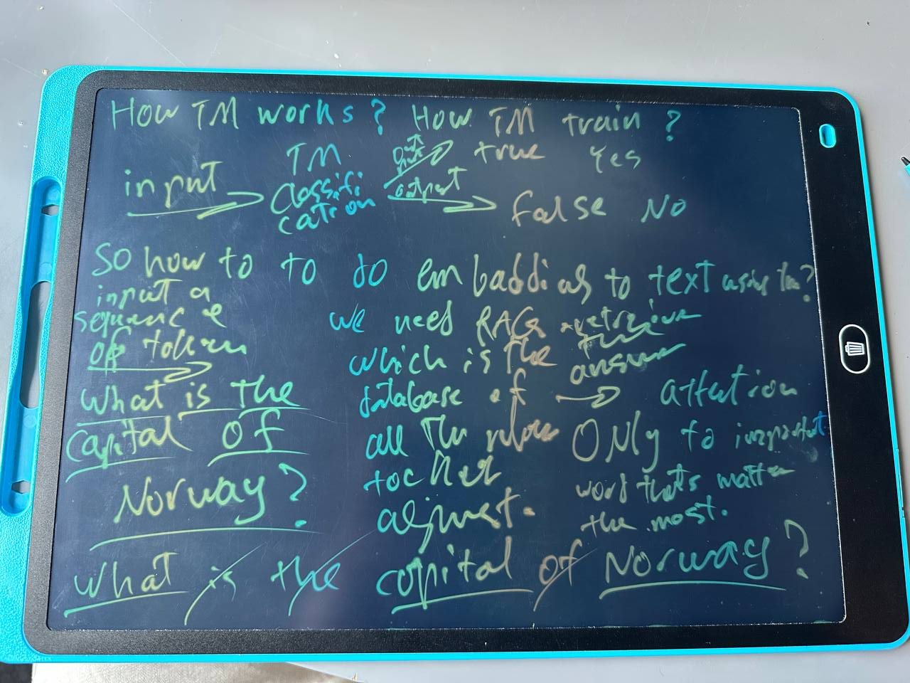

A TM takes an input, does classification, and gives an output of true or false (yes or no); the page also asks how a TM trains. It then asks how to do embedding for text with a TM when the input is a sequence of tokens, with the example "What is the capital of Norway?". The idea is that RAG is needed, as the database of all the rules, to retrieve the answer, together with attention only to the important words that matter the most ("What", "capital", "Norway" are kept; "is", "the", "of" are struck out).

## Page 2

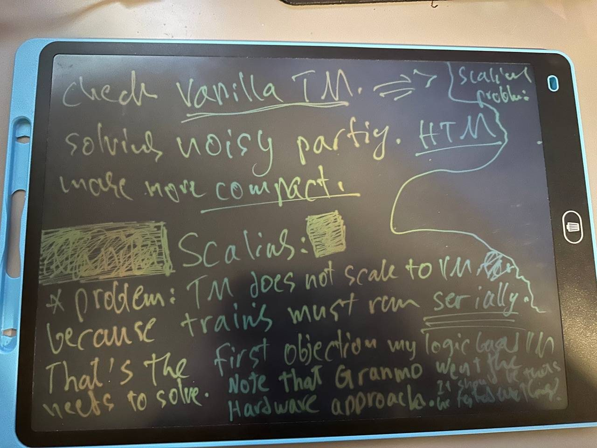

Check the vanilla TM on solving noisy parity; HTM make more compact. The scaling problem: the TM does not scale to an LLM because training must run serially, and this is the first objection the logic based LLM needs to solve. Granmo went the hardware approach; a tiny, hard-to-read note after that seems to ask whether that should be the fastest scaling.

## Page 3

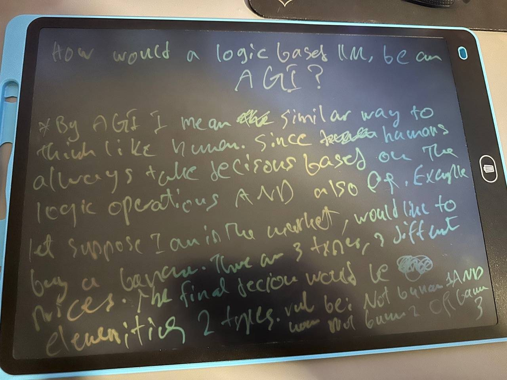

The page asks how a logic based LLM would be an AGI. AGI here means a similar way to think like a human, since humans always take decisions based on the logic operations AND and also OR. Example: in the market, wanting to buy a banana, there are 3 types and 3 different prices; the final decision is eliminating 2 types, written as "Not banan 1 AND not banan 2 OR banan 3".

## Page 4

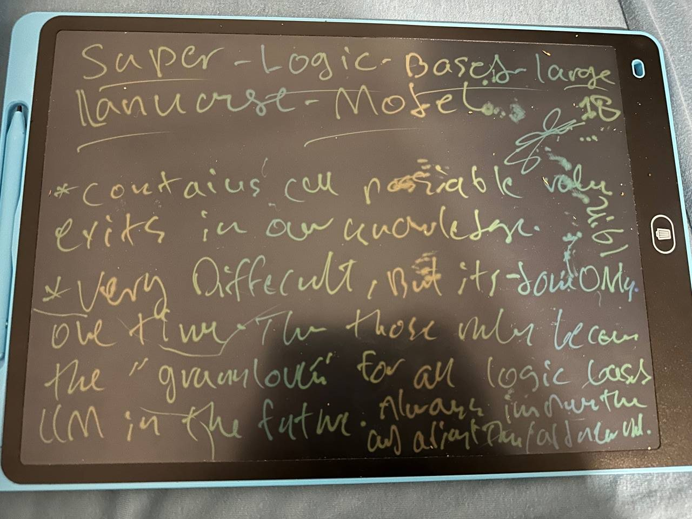

The "Super-Logic-Based-large language-Model" contains everything possible and valuable (this word is unclear, it may be "rules") that exists in our knowledge. Building it is very difficult, but it is done only one time; then those rules become the "grunnloven" (a Norwegian word, "the constitution") for all logic based LLM in the future. A small closing note says to always improve them and adjust them, and add new rules.

## Page 5

The goal has three steps. Step 1 is a logic-based LLM; step 2 adds a harness to step 1, which gives an agent; step 3 adds RL (counterfactual, with a small added word that looks like "recurse") to this agent, which corrects the rules and proposes a fix. It can also be verified and edited by a human.

## Page 6

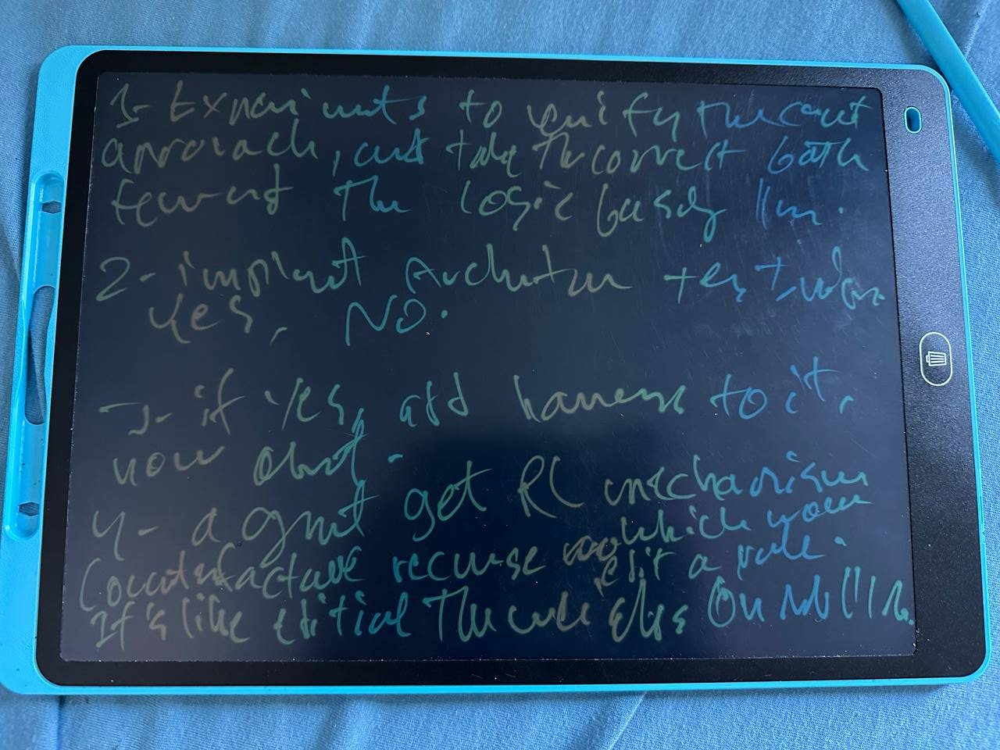

A four-step plan. Step 1: experiments to verify the correct approach and take the correct path forward for the logic based LLM. Step 2: implement the architecture and test it, with a yes or no outcome; step 3: if yes, add a harness to it. Step 4: this agent gets an RL mechanism, "counterfactual recurse", in which you edit a rule; the last sentence seems to say that this is like editing the code, as opposed to an NN LLM, but its wording is unsure.

## Page 7

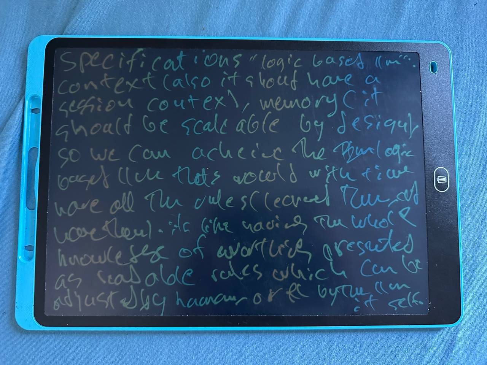

The logic based LLM needs context (also a session context) and memory, and it should be scalable by design. That way we can achieve the logic based LLM (called "pure" if a small unsure word is read right) that with time would have all the rules it has learned. That is like having the whole knowledge of everything as readable rules, which a human can adjust, or the LLM itself (apparently by RL).

## Page 8

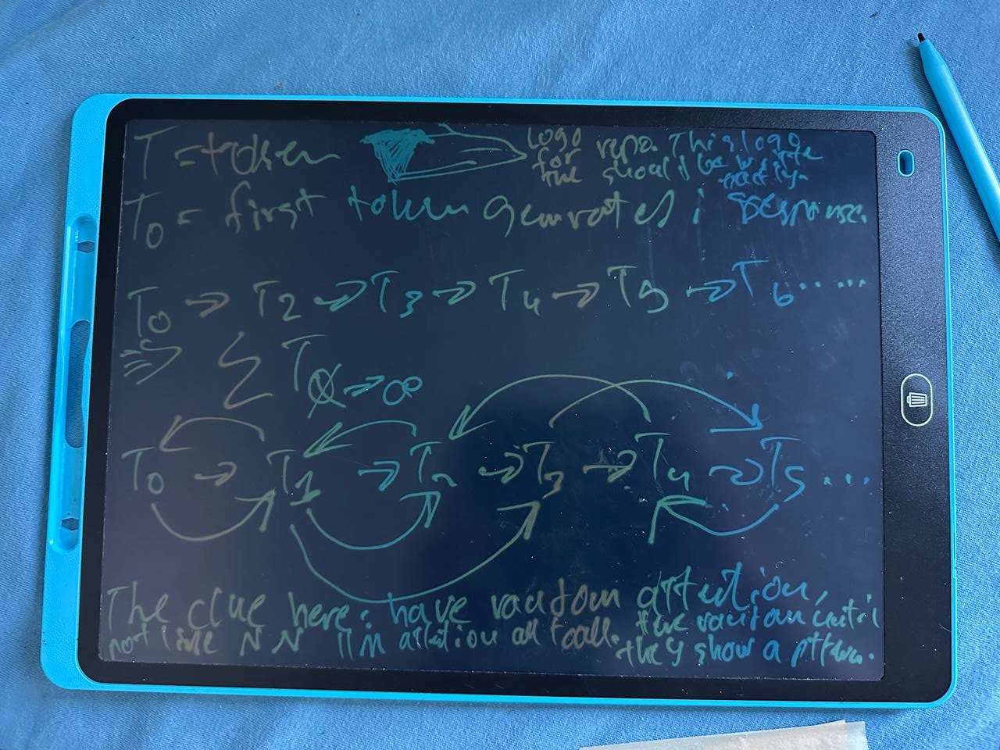

T is a token and T0 is the first token generated in the response; the tokens follow one after another, summed up towards infinity. A diagram of T0 to T5 shows curved arrows going forward and backward between tokens, some skipping a token. The clue is to have random attention, not all-to-all attention like an NN LLM, and to stay random until they show a pattern. A small sketch at the top is labelled as the logo for the repo.

## Page 9

Randomness over time leads to a pattern, so random attention would also lead to a pattern. That pattern can be used to minimise the computation for language processing. A note on the page says that the sketch of page 8 is to be the logo of the project.

## Page 10

The page shows the full pipeline for contextual language understanding (CLU) in the logic based LLM. The prompt (user input) is chunked into one token per word, every token is classified to its corresponding dimension and category, and after sorting the relation between tokens on the same dimension is calculated using GTM, as the abbreviation is read (corner note: distance). Then the relation between the different dimensions is found, which would help to understand the context. A boxed goal says: achieve context while minimizing computation to the max.

## Page 11

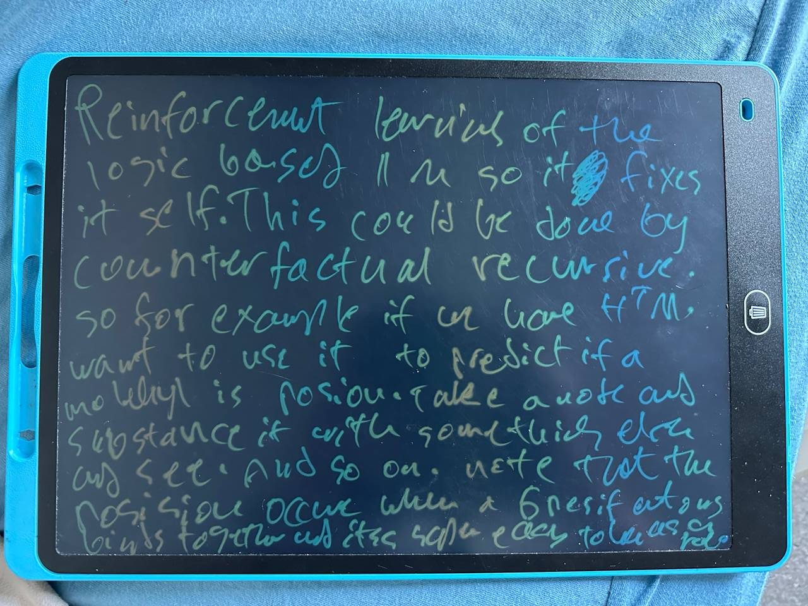

The logic based LLM should get reinforcement learning so that it fixes itself, and this could be done by "counterfactual recursive". Example: with an HTM used to predict if a molecule is poison, take a node (this word could also be "note"), replace it with something else ("substance it"), see what happens, and so on. The poison occurs when certain atoms bind together (the word before "atoms" is read as "spesif", specific, but is not sure), and that is super easy to learn as a rule.

## Page 12

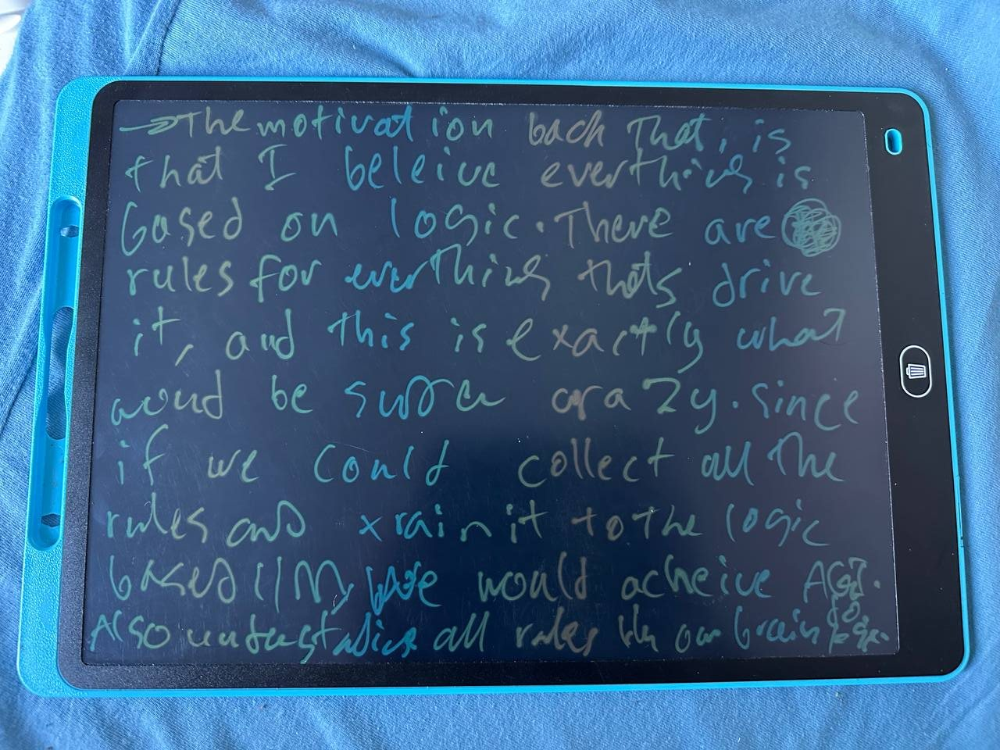

The motivation is the belief that everything is based on logic: there are rules for everything that drive it. If we could collect all the rules and train them into the logic based LLM, we would achieve AGI, and that would be super crazy. A squeezed last line adds something about also understanding all the rules of our brain and logic; its linking words are unclear.

## Page 13

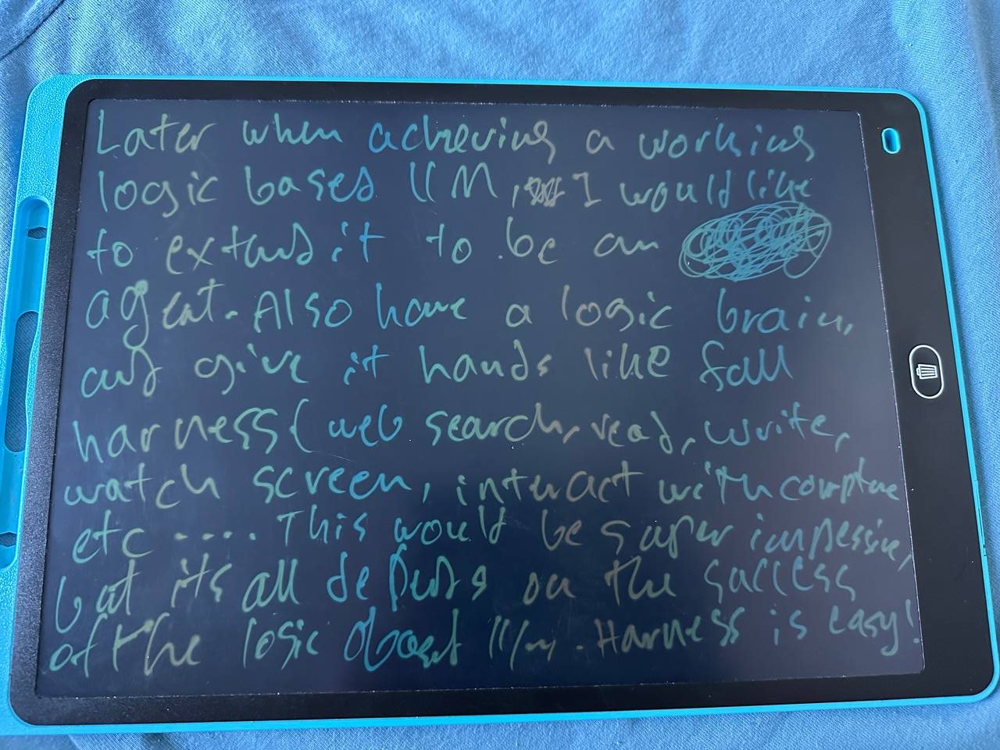

Later, once a working logic-based LLM exists, it should be extended into an agent: a "logic brain" that is given "hands" through a full harness (web search, read, write, watch the screen, interact with the computer, and so on). This would be super impressive, but it all depends on the success of the logic-based LLM. The harness part is easy.

## Page 14

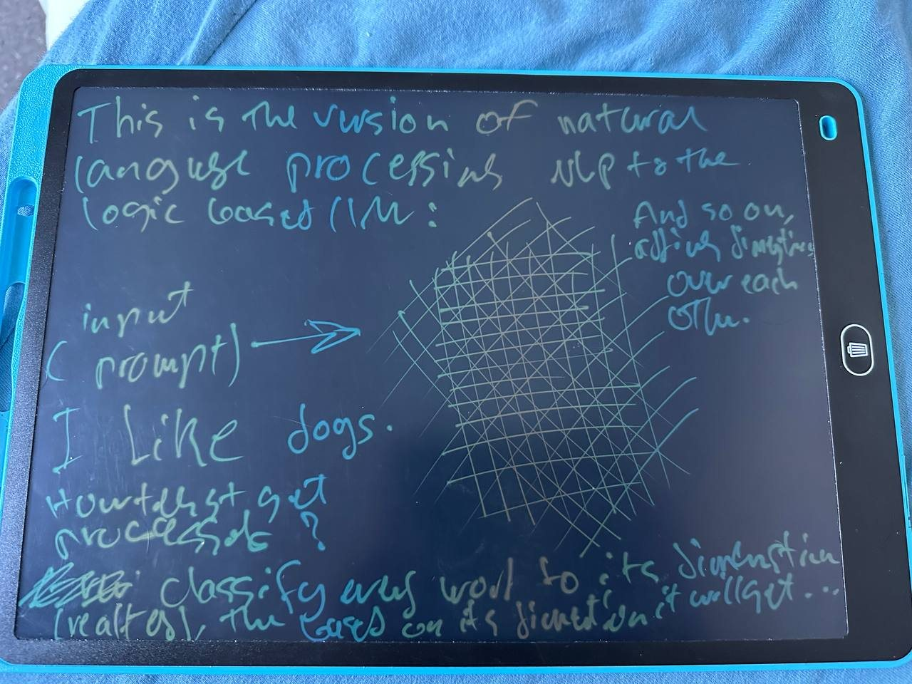

This page shows the logic-based LLM's version of natural language processing (NLP). An input prompt, with the example "I Like dogs.", goes into a drawing of many grids laid over each other, with the note "and so on, adding dimensions over each other". It asks how the input gets processed and starts the answer: classify every word to its (related) dimension, then based on its dimension it will get ... (the sentence is left unfinished).

## Page 15

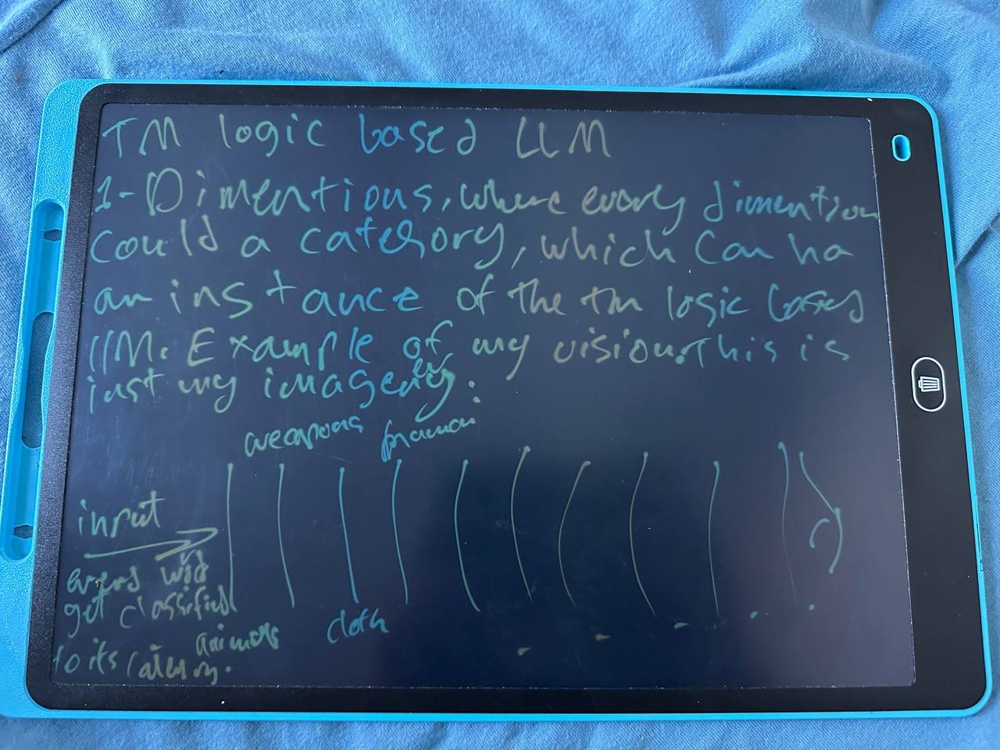

The TM logic-based LLM gets "dimensions" as point 1: every dimension could be a category, and each category can have an instance of the TM logic-based LLM. An example sketch, marked as just imagination, shows an input going into a row of columns labelled with example categories (weapons, finance [unsure], animals, cloth, and more to the right). Every word gets classified to its category.

## Page 16

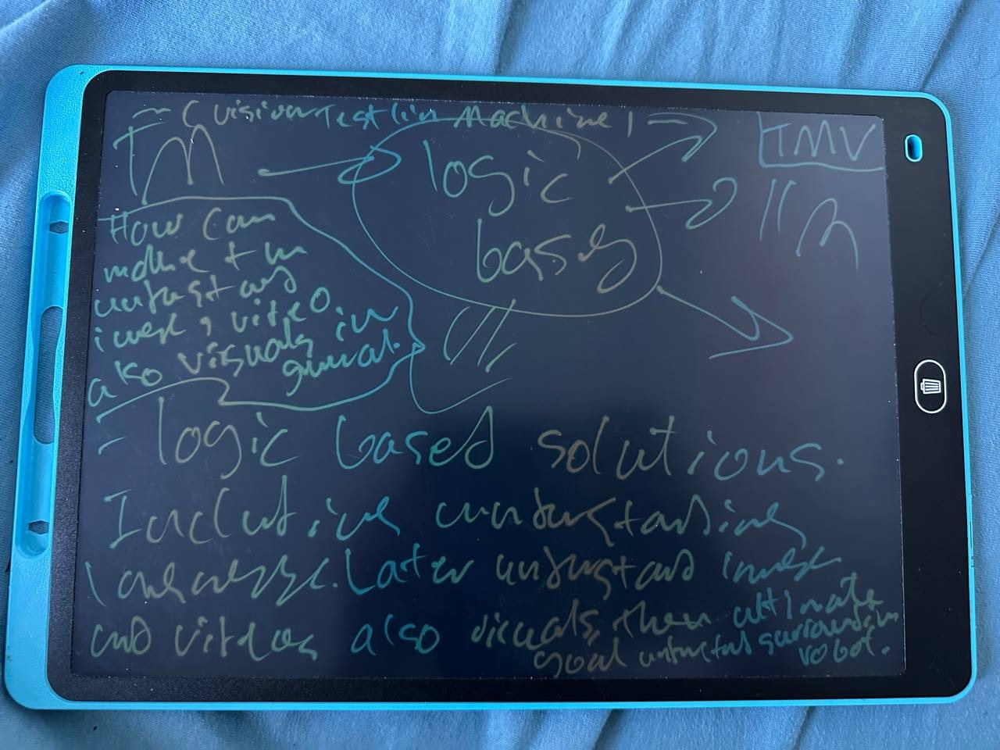

A small mind-map puts "logic based" in the centre: TM feeds into it, and it branches out to TMV (explained at the top as "vision Testlin Machine"), to llm and to a third branch that is left empty. A side note asks how to make it understand image, video and visuals in general. The plan below: logic based solutions, including understanding language; later understand image and videos, also visuals; then the ultimate goal is to understand the surroundings, with "robot" as the last word.

## Page 17

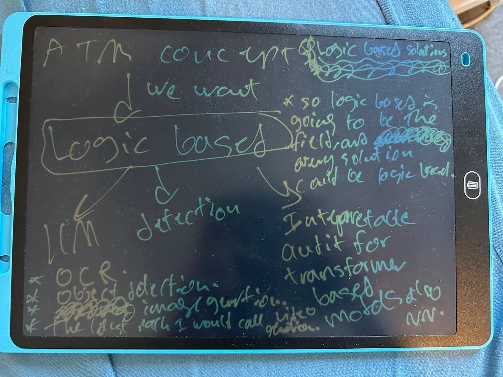

Starting from "A TM concept", what "we want" is "Logic based", and this branches into three uses: LLM, detection, and an interpretable audit for transformer based models and also NN. A side note under the heading "Logic based solutions" says logic based is going to be the field and every solution could be logic based. A list adds OCR, object detection, image generation and, as the latest path, video generation.

## Page 18

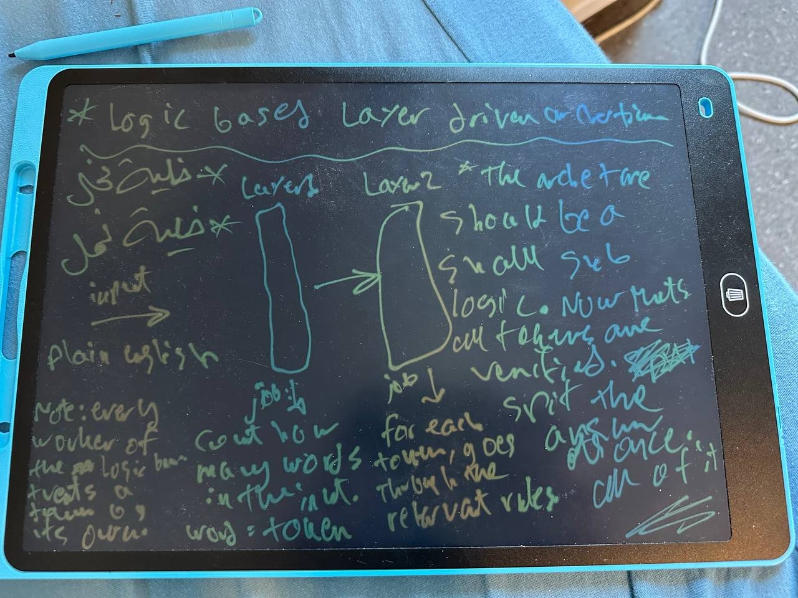

The page sketches a logic based, layer driven architecture, with "beehive" and "ant colony" written in Arabic beside it. Plain English input goes into Layer 1, whose job is to count how many words are in the input (word = token); Layer 2 then takes each token through the relevant rules. The architecture should be a small sub logic; once all tokens are verified, the answer is spit out at once, all of it. A note says every worker treats a token on its own.

## Page 19

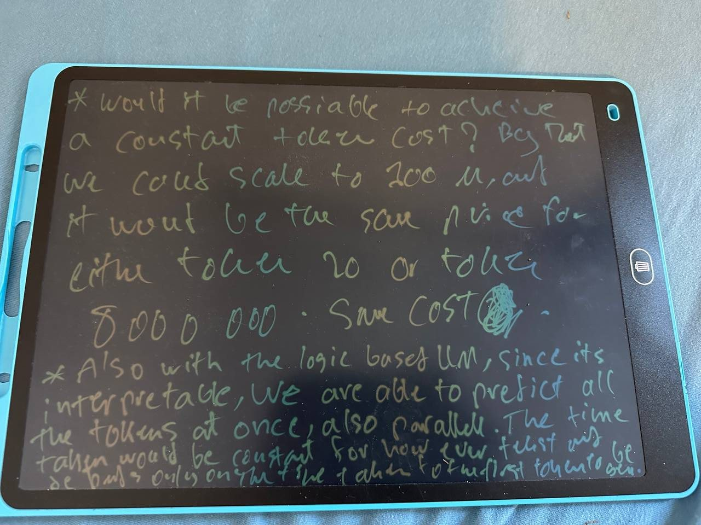

The page asks if a constant token cost can be reached, so that one could scale to 200 M and pay the same price for token 20 as for token 8000 000 ("Same COST"). It also says that the logic based LLM, because it is interpretable, can predict all the tokens at once, in parallel. The time taken would then be constant for any amount of text and depend only on the time taken for the first token to be generated.

## Page 20

The page lists the biggest advantages of the logic based LLM: no more assumptions, everything is readable rules that can be verified, no more reward hacking, no bias, and quality first. A note marked "Super Critical" fixes the wording: "logic based LLM", and not "logical based LLM" as on earlier pages.

## Page 21

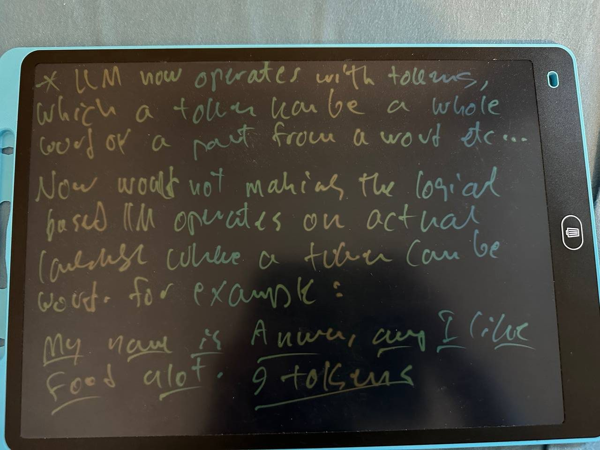

An LLM today operates with tokens, where a token can be a whole word or a part of a word. The page asks if the logic based LLM should not instead operate on actual language, where a token can be a word. The example sentence "My name is Anwar, and I like Food alot." is underlined word by word and counted as 9 tokens.

## Page 22

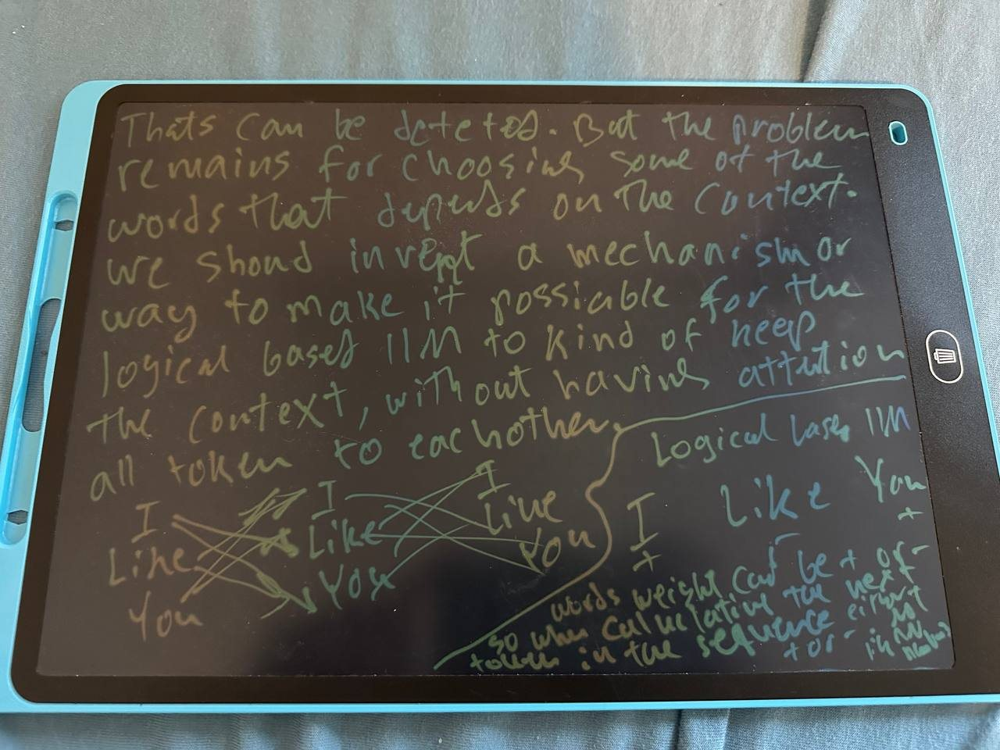

Something can be "deteted" (most likely "detected"), but the problem remains of choosing the words that depend on the context. A mechanism or way should be invented that lets the logical based LLM kind of keep the context without attention from all tokens to each other; a sketch shows "I / Like / You" three times with every word linked to every other. In a separate corner the logical based LLM version gives the words "I Like You" the signs + - +: a word's weight can be + or -, and this is used when calculating the next token in the sequence. The last squeezed words seem to compare this to NN nodes, but they are not read with certainty.

## Page 23

One of the biggest challenges with scaling the Tsetlin Machine concept to a language model is word similarity: in language many words have the same meaning, like pretty and beautiful ("she is beautiful", "she is pretty"). The solution would be that when two or more words have the same meaning regardless of the context, one is chosen at random. The page adds that a watermark in a neural language model raises the probability of chosen words, so that those words form a pattern.

## Page 24

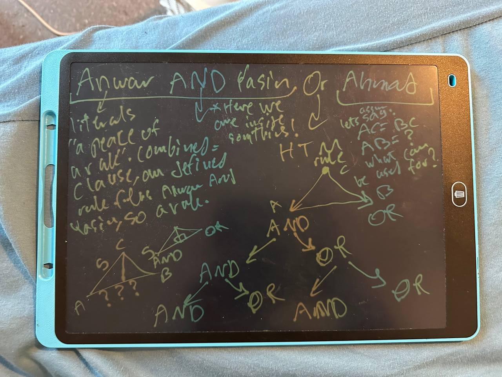

The example rule "Anwar AND Yasin Or Ahmad" is taken apart: a name is a literal, "a peace of a rule", and the literals combined are a clause, so a rule; at the AND "we are inside somthing". The Or points to an HTM drawing: a top node "rule" with arrows to AND and OR, and a tree in which each AND and each OR splits again into AND and OR. The corners are named A, B and C like a triangle, and the page asks: assume AC = BC, what is AB, and what can be used for?

## Page 25

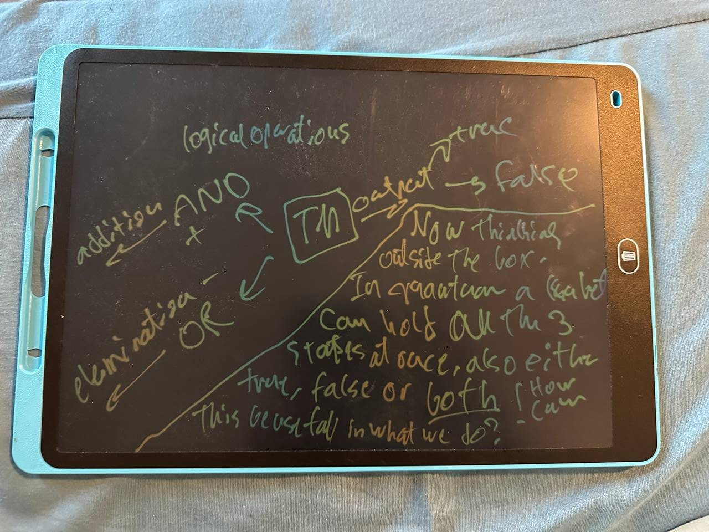

A small diagram shows a TM box with its logical operations: AND (marked "+", "addition") and OR (marked "elemination"), and an output that is true or false. Thinking outside the box: in quantum a qubit can hold all the 3 states at once, so true, false or both. The page asks how this can be useful in what we do.

## Page 26

A second photo of page 25.

## Page 27

A neural language model sends every token through all its layers and calculates a value, which is the weight for the next predicted token in the sequence. The page asks how the same can be applied to the logic based LLM: will it need to go through all the rules in order to generate the next token? If so, how can that be prevented while the quality is kept?

## Page 28

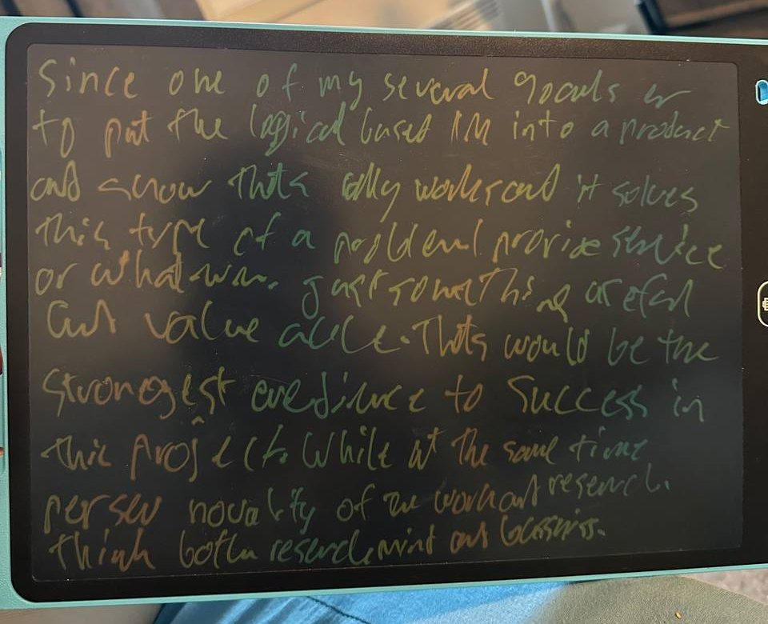

One of the goals is to put the logic-based LLM into a product and show that it really works and that it solves a type of problem, provides a service, or whatever: just something useful and valuable. That would be the strongest evidence of success in this project. At the same time the novelty of the work and research should be kept: think with both a research mind and a business mind.

## Page 29

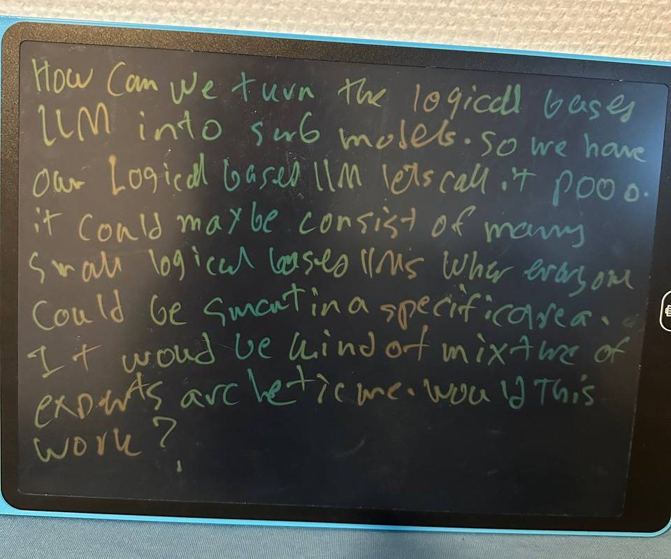

The page asks how the logic-based LLM can be turned into sub models. The idea is that the logic-based LLM (given the placeholder name "pooo") could consist of many small logic-based LLMs, where each one is smart in a specific area. This would be a kind of mixture-of-experts architecture, and the page ends by asking whether this would work.

## Page 30

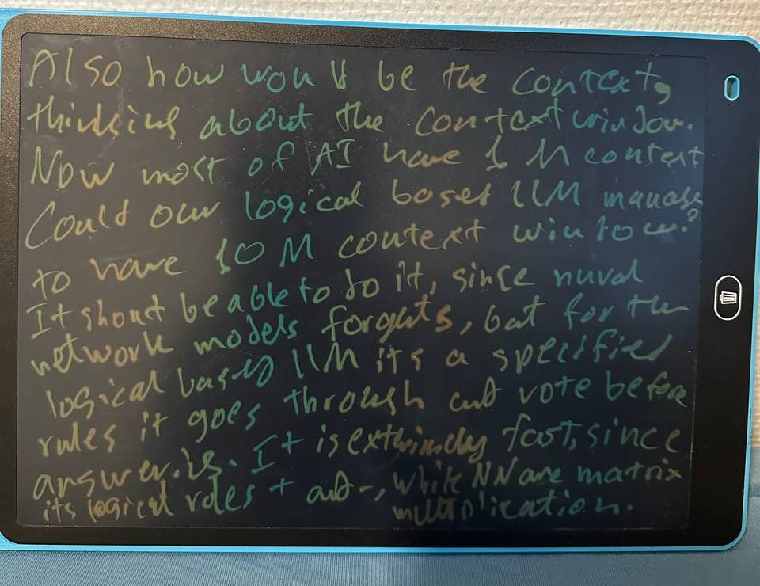

The page asks how the context would work, thinking about the context window. Most AI now have a 1 M context; could the logic-based LLM manage a 10 M context window? It should be able to, because neural network models forget, while the logic-based LLM is a set of specified rules that it goes through and that vote before the answer; it is extremely fast because it is logical rules with + and -, while NNs are matrix multiplication.

## Page 31

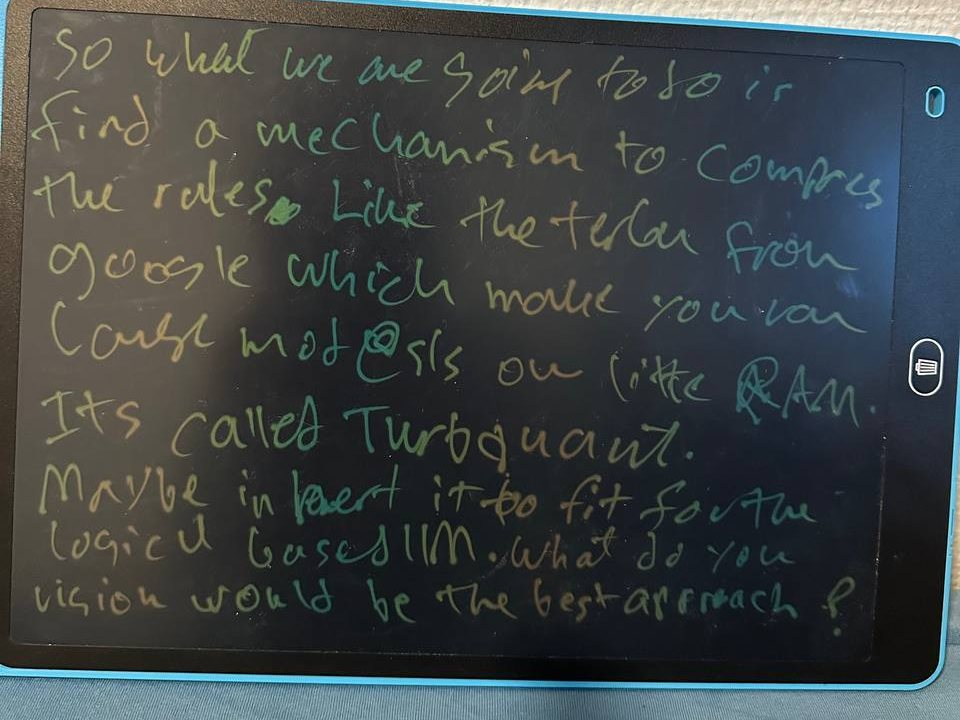

The plan is to find a mechanism that compresses the rules, like the technique from Google that lets models be loaded on little RAM, which is called TurboQuant (written "Turbquant"). Maybe it can be changed ("invert it", word unsure) so that it fits the logic-based LLM. The page ends by asking what the best approach would be.

## Page 32

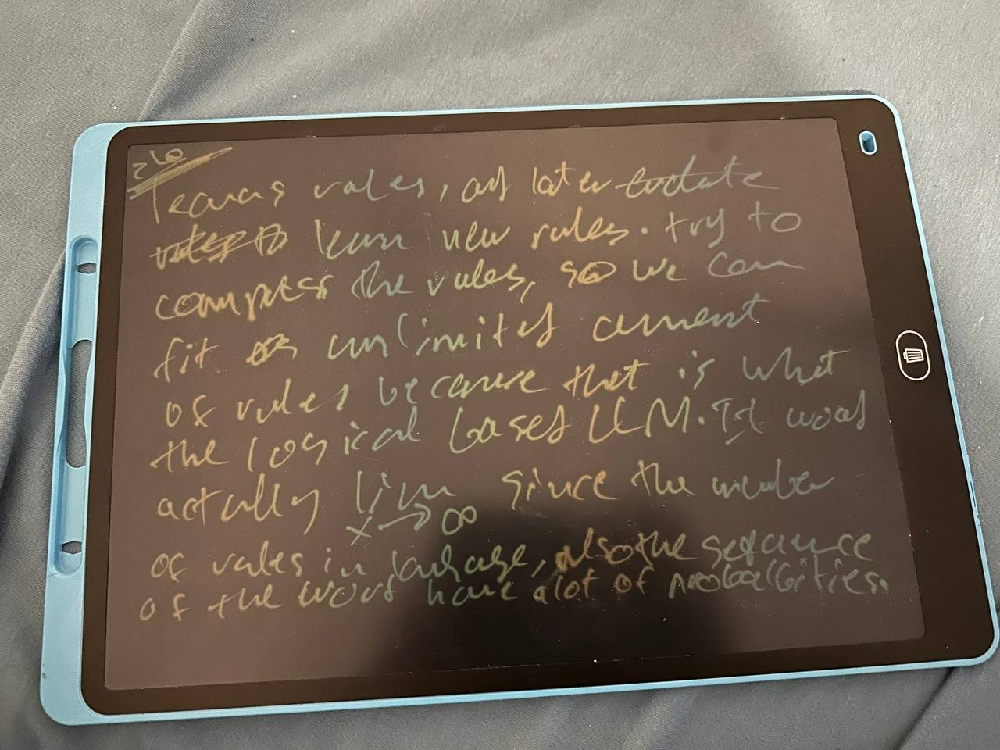

The logic-based LLM learns rules and later learns new rules. The rules should be compressed so that an unlimited amount of rules can fit, because that is what the logic-based LLM is. The amount would actually go to infinity (written as "lim x -> infinity"), since the number of rules in language and the sequences of words have a lot of probabilities.
