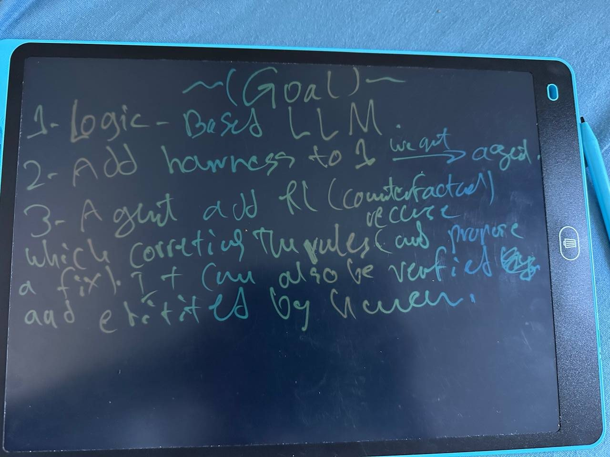
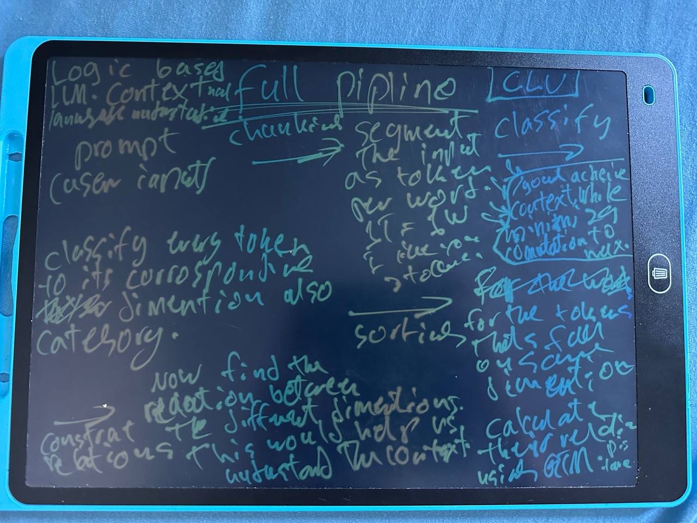

# The ideas and the open questions

This page records the ideas as they were first written down, on a writing board and in notes, before any literature was read. The wording follows the notes. What the literature says about each idea is on the [findings page](findings.md); the photos of the board are in [board/](board/README.md).

## The goal

A logic based LLM: a language model built from Tsetlin Machines, so from rules and not from neural weights, interpretable and cheap to run. It is meant as a programme that goes the whole way, "from the raw oil to the petrol that goes to the cars": from the basic idea to a tested, working system, with real tests and no result made to look good.

The goal ladder on the board (photos 5, 6 and 13):

1. the logic based LLM;
2. a harness around it, which makes it an agent;
3. learning by "counterfactual recursive" edits of rules that a human can verify.

Photo 28 adds a fourth point: put the model into a product that is useful, as the strongest evidence that it works, and keep the research novelty while doing so.

## Idea 1: NTMA, a team of Tsetlin Machine types

Full name on the notes: "Neurons-Tsetlin-Machine-Architecture: the way toward logic based mind and rational thinking".

- The body has three types of neurons. Replace the types of neurons with types of Tsetlin Machine: the Graph Tsetlin Machine, the Hierarchical Tsetlin Machine and the plain Tsetlin Machine.
- Add more types, such as the ones of the author's earlier repositories, or invent a type for one specific job.
- Different neurons work together as one team.
- The Graph Tsetlin Machine could capture distance and relations between words.

## Idea 2: QTMA, an automaton that is both states at once

Full name on the notes: "Quantum Tsetlin Machine Automata: where logic alone is no longer enough".

- The dual state of the automaton: an automaton could be positive and negative at the same time. That gives true, false, and true-and-false at once, as in quantum mechanics.
- Today the Tsetlin Machine works on 0 and 1. Make it work on qubits, which hold the states at the same time, so that all possibilities are gone through at once.
- Board (photos 25 and 26): a qubit can hold all three states at once, true, false or both. How can this be useful here?

## Idea 3: CDE, a category-dimension embedding

- The diagnosis behind it: the open problem for Tsetlin Machines on language is the embedding, that is, how to turn words and visual objects into symbols the machine can process, with distance and relations between words (dog near puppy, far from tax return).
- Classify every word of the language into predefined categories; every category is a dimension. Use chunking to move inside categories, and index the categories that are used most.
- Example prompt: "My name is Mendel, and i love apple." Every word is a token; look up the category of each token, which is a classification and so a task the Tsetlin Machine handles. What happens after the lookup was left open.

The pipeline as drawn on the board (photos 10, 14 and 15), called contextual language understanding:

1. The prompt is chunked into one token per word.
2. Every token is classified to its dimension and category.
3. The tokens are sorted.
4. The relation between tokens on the same dimension is computed with the Graph Tsetlin Machine ("distance").
5. The relation between the dimensions is computed; this gives the context.
6. Boxed goal: achieve context while minimising computation.
7. Dimensions are stacked over each other like grids. Each category could have its own instance of the model (drawn as columns: weapons, finance, animals, cloth and so on).

## Other ideas on the board

- Photos 8 and 9: random attention instead of attention from every token to every token, kept random until a pattern shows.
- Photo 22: a plus or minus weight per word, used when the next token is computed.
- Photo 24: a rule is a set of literals joined into a clause ("Anwar AND Yasin OR Ahmad"); the Hierarchical Tsetlin Machine is drawn as a tree in which AND and OR split again into AND and OR.
- Photo 18: a layer-driven architecture in the manner of a beehive or an ant colony, in which every worker treats one token on its own.
- Photos 16 and 17: logic based solutions as a field, with language first and vision, detection and the audit of neural models after it.

## Open questions

- Photo 27: a neural language model sends every token through all its layers. Must the logic based LLM go through all rules to generate the next token? If so, how can that be avoided while the quality is kept?
- Photo 19: is a constant cost per token possible, the same for token 20 as for token 8,000,000? Since the model is interpretable, can all tokens be predicted at once, in parallel?
- Photo 30: could the model manage a context window of 10 million tokens? The argument on the board: neural networks forget, while rules are specified, vote, and are fast, plus and minus against matrix multiplication.
- Photos 31 and 32: can the rules be compressed, in the way TurboQuant lets models load on little memory, given that the number of rules goes to infinity?
- Photo 29: could the model consist of many small logic based LLMs, each good in one area, a kind of mixture of experts?
- Photos 25 and 26: how can "true, false or both" be useful?

Short answers to these questions, from the literature, are at the end of the [findings page](findings.md#the-board-questions-short-answers).

## Fixed wording

The term is "logic based LLM", not "logical based LLM" (photo 20). Some earlier pages of the board still carry the second form.
